# Events — Sam's dinner: who was invited, and who came

**Sam** hosts a dinner for people from two of Sam's groups: **The House**,
Sam's roommates, and **dWeb**, Sam's colleagues. Sam posts it once, to
both. **Bo** and **Fay** answer from their computers, **Cy** from her
phone, all three in The House; **Di** from his computer and **Eve** from
her phone, in dWeb. Bo brings a friend, **Maya**, who has nothing
installed and is in no group: she is a name Bo types. The next morning
Sam's page says, for each group, who was invited, who said they were
coming, and who came. Nobody makes an account, and nothing anyone sees
says that someone declined.

You need what `start.md` gives each person: svrngs on each computer, a
home page there, and on a phone the group's page, opened from the group's
link once. Where a step says *paste this line in a terminal*: open
Terminal (in Applications, then Utilities), paste the line, and press
Enter.

Every button below is one a recorded run pressed, on one computer, with a
program playing each person. **The run**,
`runs/events/2026-10-14/README.md`, is the whole story. Its numbers are
its clean take's (`data/summary.json`), and its pictures its shots take's
(`data/shots/`, README "The shots take"), taken before the app offered a
link, so Sam's page there has none. **The link take**,
`runs/events/2026-10-14-links/README.md`, copies the dinner's link and
opens it on phones and computers, with Sam's computer asleep, stopped and
frozen (`data/summary.json` and `data/shots/` there).

## What this is

**Events is an app, not svrngs.** It is the reference app for an event
(svrn-docs `rings/current/EVENTS.md` §0, §5), in `apps/events/`: one way
to do it, with its makers' opinions, and someone else may build another
on the same pieces.

An event is a post in a group, and people answer it. Three things are
written in the group's shared history: the post, by whoever hosts; "I'm
coming", optionally with guests' names, by each person for themselves;
and "I came", by each person for themselves, or by the person who brought
a guest, for that guest.

Who was invited is whoever is in the group, so no one keeps a list. The
run decided "in the group now", not "in the group when it was posted":
Fay joined after the post, and she could see it and answer (README, "What
invited means").

Nothing records "no". "Take my name off" takes back your own "I'm
coming", and no page says that anyone is not coming or did not come.

Events live in lasting groups, and no event makes a group. A dinner drawn
from two groups is posted in each, and each group's history holds only its
own people's answers. Only Sam, who hosts, sees both.

svrngs had built all the app uses before the app (EVENTS.md §2): who is
asking, on every request, so the app needs no sign-in; the group's
history, which the app writes to and reads back on Sam's computer; who is
in each group; lending, so Sam's computer offers the app to Sam's groups;
and a way to change your own answer later. svrngs's code holds no word of
the app's (`apps/events/nouns.txt`, `scripts/vocab_check.py`).

## Sam: lend the app and post the dinner

**1. Run the app, and lend it.** Today the app runs from a copy of svrngs
on Sam's computer, with Node.js installed. In a terminal, in that copy:

```
echo "{\"record\": \"$(cat ~/.svrngs/api)\", \"token\": \"$HOME/.svrngs/token\", \"who\": \"x-svrngs-key\"}" > ~/events.json
node apps/events/server.mjs ~/events.json
```

The first writes the app's settings, as the run wrote them (`run.py`
`app`); the second prints the app's number, `{"port":65216,"store":"record"}`
in the run (`apps/events/server.mjs:316`). Leave that window open: the app
runs while it is. In a second terminal, with that number:

```
~/.local/bin/svrngs share 65216 --kind events --name events
```

It asks *"If events takes a password on each request, paste what it takes
in its Authorization header, then press Enter (Enter alone for none)"*.
Press **Enter**. It says:

```
You lend events (port 65216) to everyone in your groups, as many at once as want it. …
svrngs is running here already, so they can open it now.
`svrngs unshare events` stops lending it.
```

One lend reaches both groups: The House and dWeb each list it as
**Sam’s events**.

**2. Open it.** On Sam's home page, press **Open Sam’s events**, under
either group (the run opened the address that link opens, the one Sam's
computer lists for the lend, `home.js:90`). The app's page says
**Events**, each group with *"Nothing posted yet."*, and **Post an
event** below.

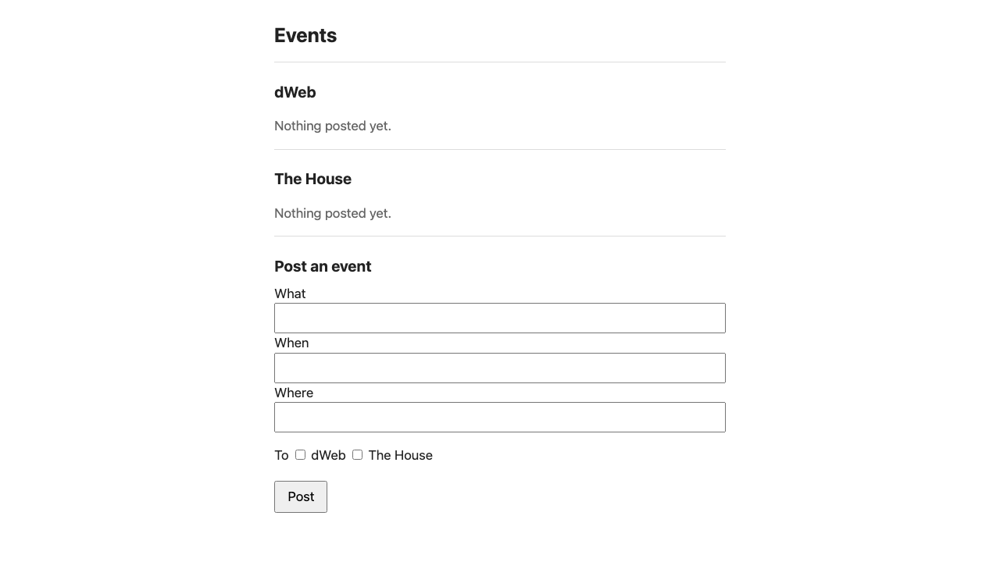

**3. Post the dinner, once, to both groups.** Type in **What**, **When**
and **Where** (the run: `Dinner`, `Friday 7`, `the house`), tick both
groups beside **To**, and press **Post**. The dinner's page opens (145 ms
in the run): *"Sam is hosting."*, then each group with its people under
**Invited**, *"No one has said yet."* under **Coming** and *"No one yet."*
under **Came**, and at the end of each group's part *"To send in <the
group>'s chat:"*, the dinner's link for that group. Sam sees both groups;
no one else will.

**4. Send each group its link.** In The House's part press **Copy the
link to this event**: it says **Copied** (in the link take, both times),
and the link is ready to paste. Paste it in The House's own chat, however
your roommates talk. Then the same in dWeb's part, for dWeb's chat. Each
group gets its own link, and it opens the dinner only for that group's
people: someone in dWeb who opens The House's is told the dinner is not
theirs (step 7). The link carries no password.

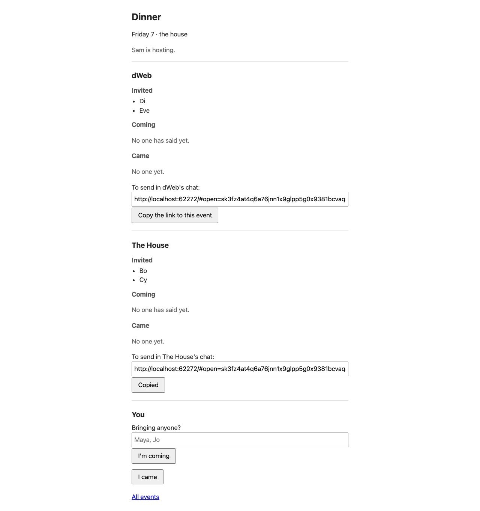

## Everyone else: say you're coming

**5. Bo, on a computer.** Bo opens the link from The House's chat. His
browser says *"This link opens in svrngs on your computer."* and shows
the link again, with **Copy**. He copies it, opens his svrngs home page,
pastes it under **Open a link from your group**, and presses **Open it**
(the link take pasted the link that page showed): the dinner opens in a
tab of its own (36 ms there). The page that says it opens in svrngs also shows a name box, Join,
Yes and Not now; Bo leaves them ("When something does not work").

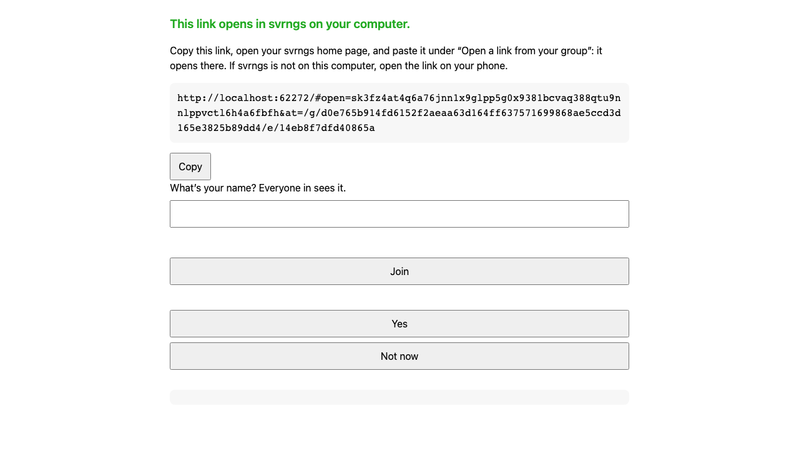
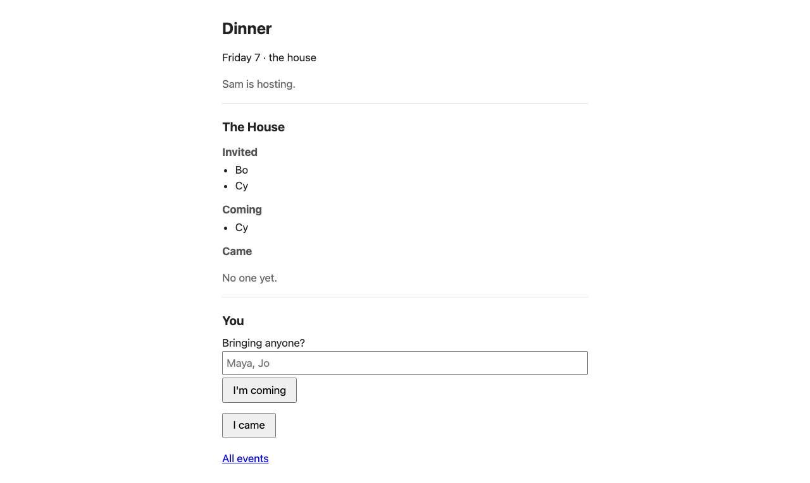

The other way, with no link: on the home page, under The House, press
**Open Sam’s events**, and in the app's list, **Dinner** (the run's shots
take).

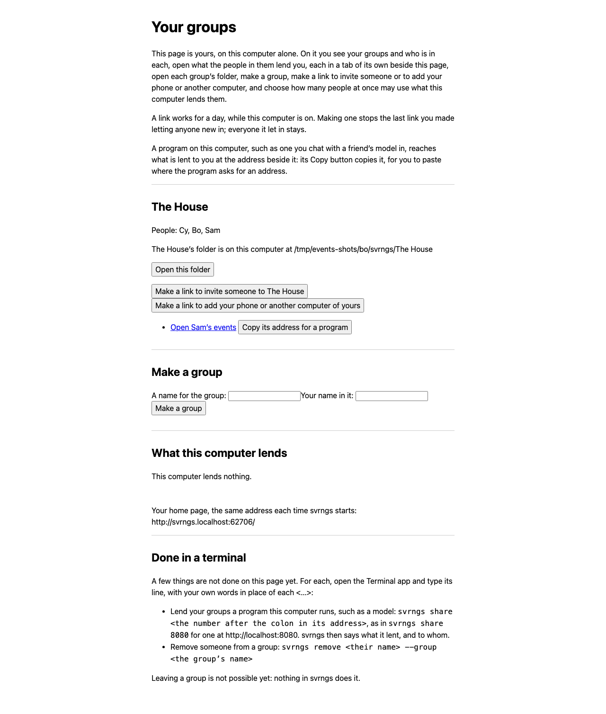

Bo sees The House alone: its people, who is coming and who came. dWeb's
are not on his page.

**6. Bo says he's coming, and brings Maya.** Press **I'm coming**: Bo is
under **Coming** (77 ms in the run). Then, changing his mind, he types
`Maya` under *"Bringing anyone?"* and presses **Save**: Coming says
**Bo + Maya** (64 ms). Saving again changes it; **Take my name off**
takes it back.

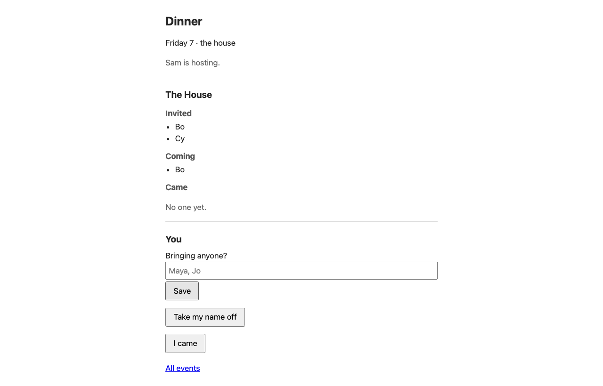
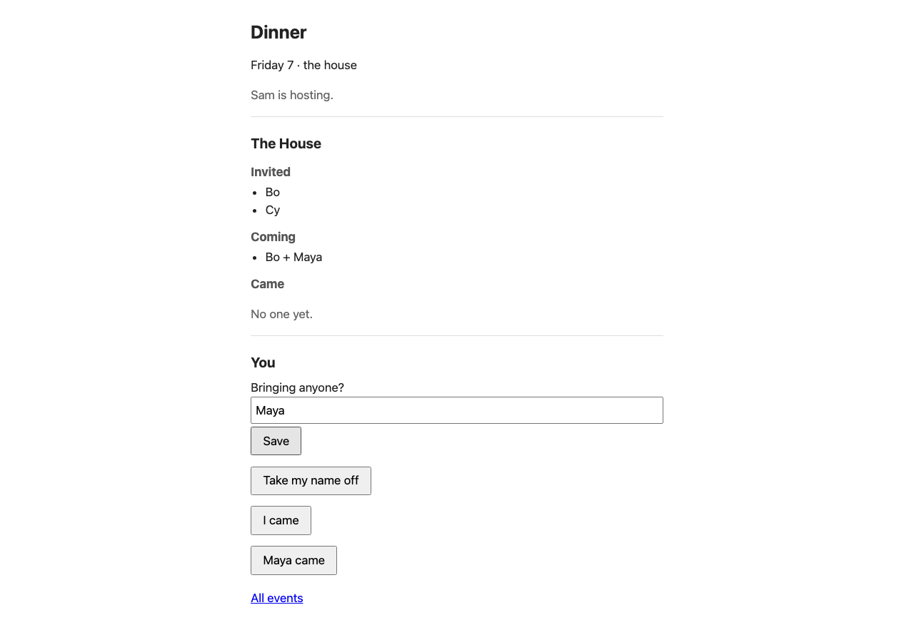

**7. Cy, on a phone.** Cy taps the link in The House's chat, on the
phone she joined with: the dinner opens (1.8 s in the link take), then
she taps **I'm coming** (198 ms in the run).

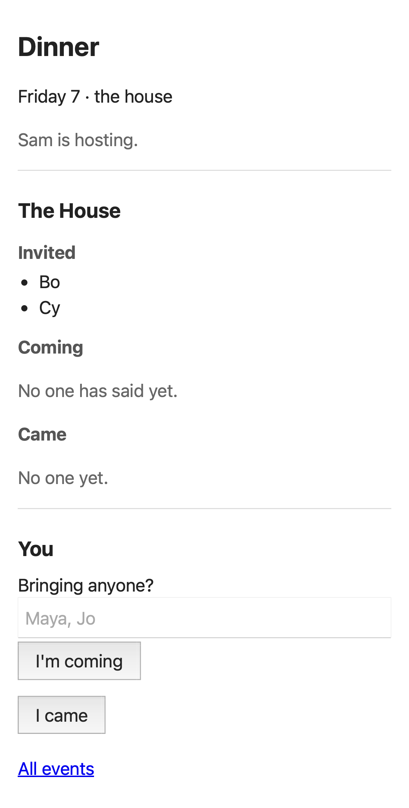

Had she tapped dWeb's link, her phone would say *"You're not in dWeb, so
this event isn't yours to see."*, and nothing of dWeb's.


The other way, with no link: open the group's page, tap **Sam’s events**,
then **Dinner** (the run's shots take, 0.7 s and 1.0 s).

**8. Di and Eve, in dWeb.** The same with dWeb's link, on Di's computer
and Eve's phone: their page shows dWeb alone, Di and Eve under Invited.
Each presses **I'm coming** (70 ms and 208 ms in the run).

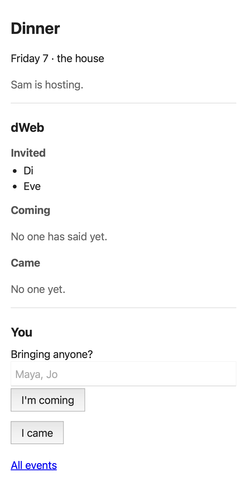

**9. Eve changes her mind.** She presses **Take my name off**. Her name
leaves Coming, and she is back to only Invited. Nothing on any page says
she is not coming.

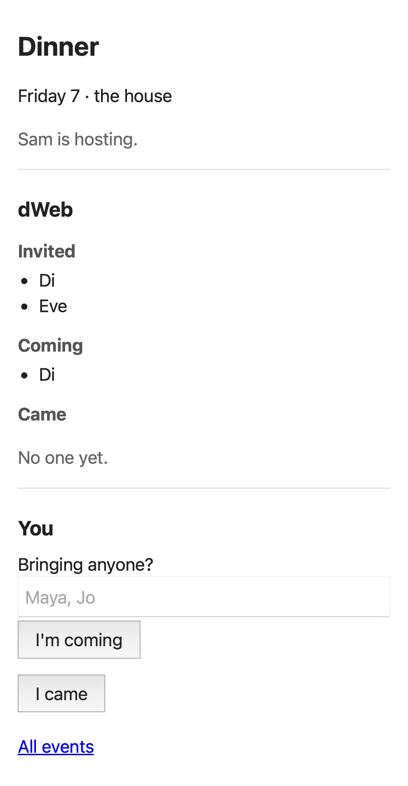

## At the dinner: say you came

**10. Each person presses I came.** Bo presses **I came**, and then
**Maya came**: only Bo's page offers it, since Bo brought her. Cy presses
**I came**; her page offers no "Maya came". Di presses **I came**: his
computer was asleep while Eve took her name off, and once it woke it held
everything it had missed within a second (854 ms).

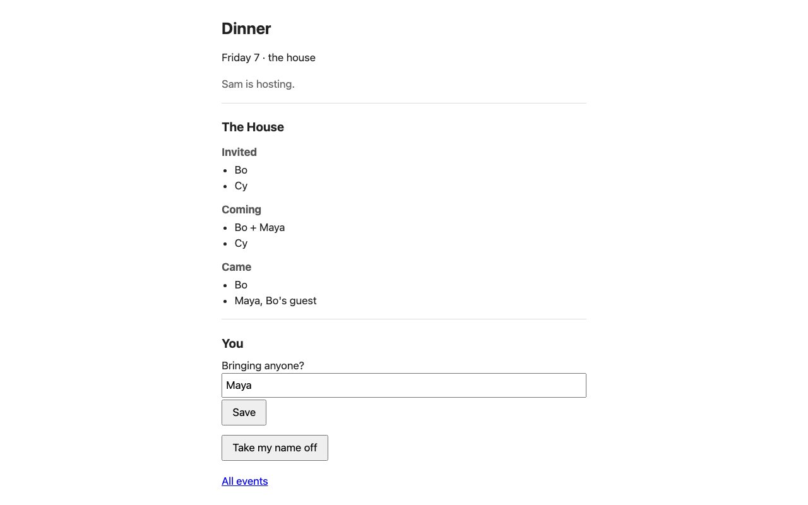
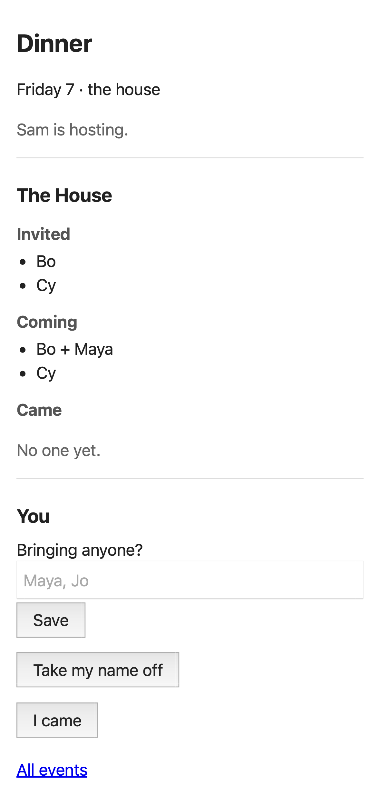

**11. Fay joins The House after the post.** Bo makes a link to The House
(on his home page, `start.md` step 4; the run typed `svrngs link "The
House"`) and Fay joins by it. Fay's Sam’s events lists Dinner;
she opens it, sees herself under Invited, and presses **I'm coming**.

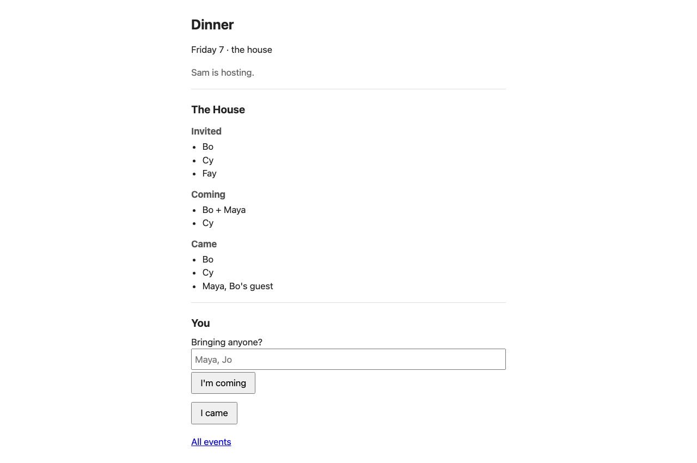

## The next morning: who was invited, and who came

**12. Sam opens the dinner.** One page, each group in its own part:

- **The House**: invited Bo, Cy, Fay; coming *Bo + Maya*, Cy, Fay; came
  Bo, Cy, *Maya, Bo's guest*.
- **dWeb**: invited Di, Eve; coming Di; came Di.

Eve is under Invited and nowhere else. Every computer holding each group
gives the same answers (README, prediction 7). Each answer is its own
person's, signed on their own computer or phone as the app on Sam's
computer named it, so none says it came through Sam's computer; the
Events scene holds this on every gate (`crates/svrngs/tests/scenes/events.rs`).

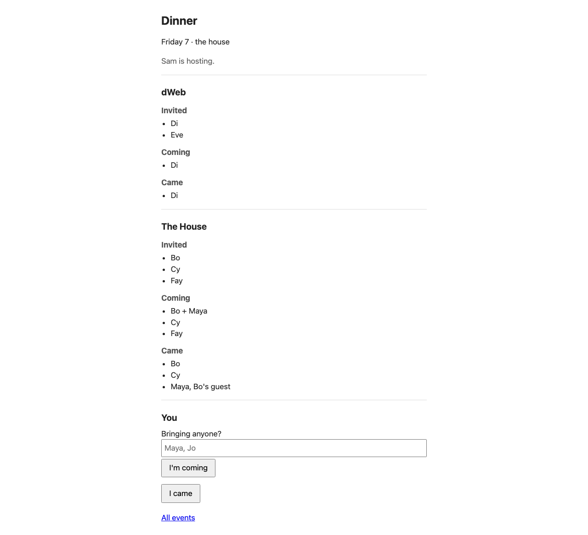

Bo, Cy and Fay see The House's part alone; Di and Eve see dWeb's alone.

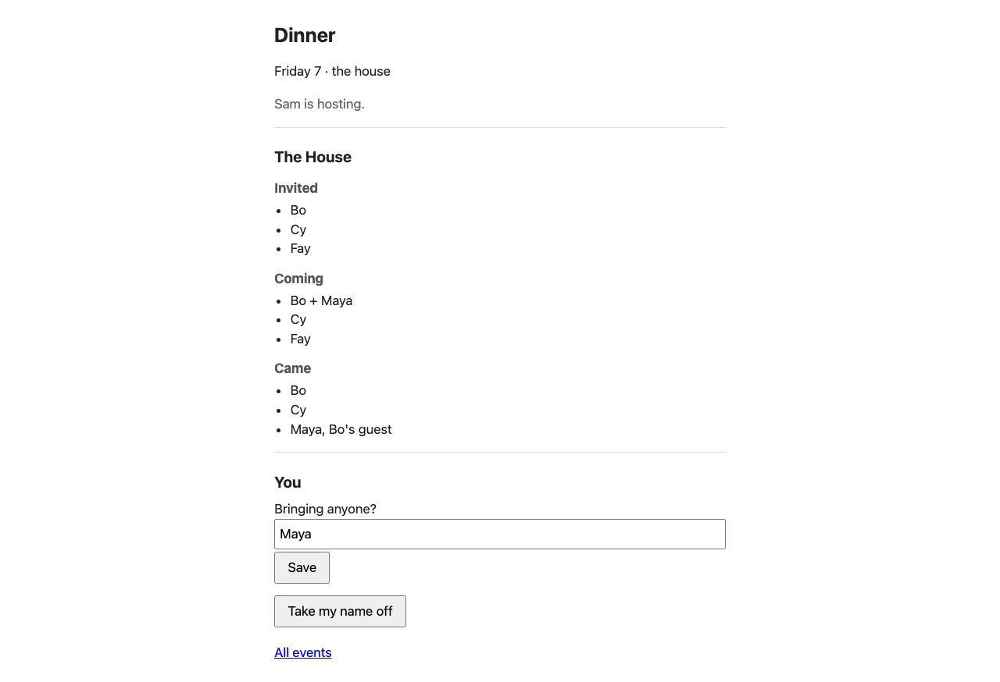

## When Sam's computer is asleep

The app runs on Sam's computer, so while it is asleep or off, no one
reaches the dinner, though Bo's and Fay's computers hold every answer.
What each person sees (the link take, Sam's svrngs stopped, then frozen as
a lid closing):

- **Bo, on a computer**, pasting the link on his home page: after about
  4 seconds (4,036 and 4,038 ms), a tab that says
  `{"error":"the computer that lends this did not answer; try again later","kind":"away"}`.
  His home page says, under The House, *"Sam's computer did not answer,
  so what they lend is not listed."* (about 3 seconds).

  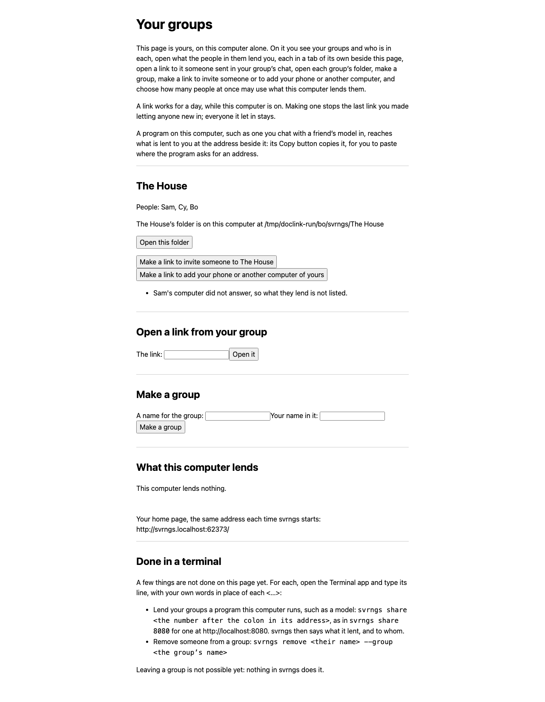
- **Cy, on a phone, with the dinner open**: opening it again, after about
  4 seconds (4,018 and 4,221 ms), *"The computer lending this did not
  answer. Try again later."*

  
- **Cy, on a phone, tapping the link again**: after **30 seconds**
  (30,497 and 30,522 ms), *"Your group’s computer did not answer through
  usw1-1.relay.n0.iroh.link. Try again later."*, with a name box, Join,
  Yes and Not now below it. The phone asks Sam's computer, whose link Cy
  joined by, before it opens anything ("What svrngs lacked").

  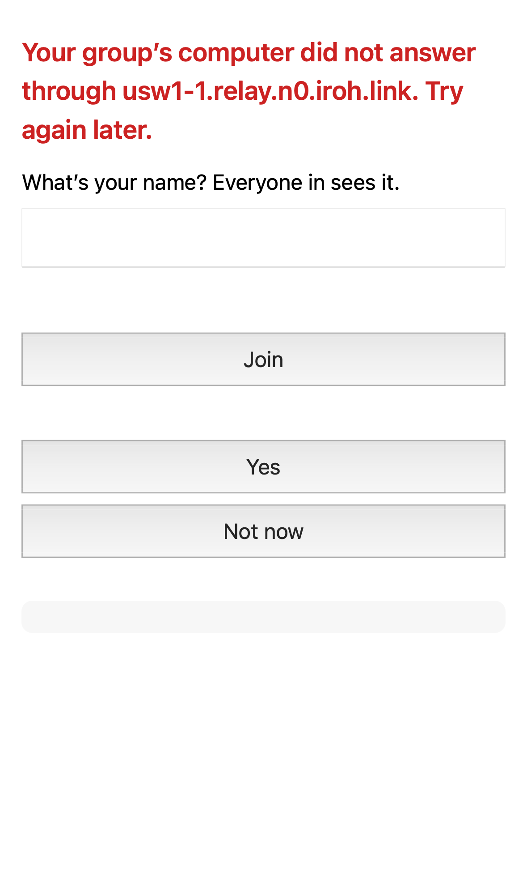

Nothing anyone said is lost. When Sam's computer is on again, the same
link opens the dinner with every answer: within 0.5–1.4 s of Sam's svrngs
starting on Bo's computer, 2.4–3.4 s on Cy's phone, in the link take.

## When something does not work

Each of these is something the run met, or words the app or svrngs says,
with what to do.

- **`{"error":"the computer that lends this did not answer; try again later","kind":"away"}`**
  on a computer, or *"The computer lending this did not answer. Try again
  later."* on a phone, after about 4 seconds. Sam's computer is asleep or
  off, and the app runs there. Try again when it is on ("When Sam's
  computer is asleep").
- **"Your group’s computer did not answer through …"** on a phone, after
  30 seconds, when you tap the link. The computer whose link you joined by
  is asleep or off; when it is Sam's, the dinner is out of reach too. Try
  again when it is on.
- **"This link opens in svrngs on your computer."** You opened the link
  in a browser on a computer. Copy it, open your svrngs home page, and
  paste it under **Open a link from your group** (step 5). If svrngs is
  not on this computer, open the link on your phone.
- **"<the group> keeps no page for links, so there's no link to send."**
  on Sam's page. The group was made without a page for links. Tell its
  people the dinner is under **Sam’s events**; not met in the runs (the
  app's words, `apps/events/server.mjs:236`).
- **"This group can't be read on this computer right now."** The app,
  on Sam's computer, could not read the group: svrngs is not running there
  while the app is. Start svrngs on Sam's computer (`start.md`, "The home
  page does not open").
- **"You're not in dWeb, so this event isn't yours to see."** (or The
  House). You opened the other group's link to the dinner. Open the one
  sent in your own group's chat, or the dinner from **Sam’s events** there.
- **A name box, Join, Yes and Not now** on the group's page, after you
  joined, or under *"This link opens in svrngs on your computer."* A
  mistake of the group's page (`web/index.html:53`, start-run's finding).
  Leave them.
- **No "Maya came" button.** Only the person who brought a guest says
  they came. Ask them.
- **The dinner opens on dWeb's part first**, after Sam presses Post. The
  app lands on whichever group the computer lists first (the run's finding
  5, `02-sam-1.png`); Sam's page holds both groups either way.
- **Sam’s events is not listed** on a home page or a phone's page. Sam's
  computer is asleep, or the app is not lent. A home page says it as
  *"Sam's computer did not answer, so what they lend is not listed."*
  (`crates/svrngs-node/src/home/home.js:95`; met in the link take, Bo's
  home page while Sam's computer slept).

## What svrngs lacked

The run found two things svrngs lacked, each written for the operator in
its `NEEDS_HUMAN.md`; the app worked around neither. svrngs gives both
now, and the link take found one more:

1. **A person waited 30 s to be told Sam's computer is asleep** (the run,
   30,019 ms). Now svrngs gives up a dial to the computer lending
   something after 4 s, three times the slowest working dial measured on
   this host (events-asleep, events-wait; `crates/svrngs-node/src/dial.rs`):
   told in 4.0–4.2 s in the link take, on a computer and a phone, Sam's
   computer stopped or frozen.
2. **There was no link for the dinner.** Now svrngs tells the app where it
   is lent and each group's page (events-links), and the app writes each
   group's link for Sam to copy (step 4). On a computer it opens by one
   paste on the home page (step 5); a browser there cannot find the
   computer's own svrngs by itself.
3. **Still lacking: a phone tapping the link while the computer it joined
   through is asleep waits 30 s**, and is told so in a relay's name
   (30,497 and 30,522 ms, the link take). The phone's page asks that
   computer first, and that wait was left as iroh's when the dial to a
   lend was capped. Written for the operator, with its lines estimated, in
   `runs/events/2026-10-14-links/NEEDS_HUMAN.md`.

And while Sam's computer sleeps no one reaches the dinner, though Bo's and
Fay's computers hold every answer: a second computer lending the app would
keep it up (the run's README, finding 4); not run.

## The demo: bars, proposed

Written 2026-10-14 for the launch story (the operator: "so many stories
start with an event, who was invited and who actually came"). PLAN §4
names this demo.

Gate (the seat's proposal, the operator's to set): **Sam**, with the app
lent, posts a dinner to two groups in one form within two minutes, typing
only what, when and where; **each person**, from their home page or
phone's page, says they're coming within one minute, typing nothing but a
guest's name; the next morning Sam reads, on one page, each group's
invited, coming and came, a guest by name beside the person who brought
them; no one reads another group's answers; no page shows anyone
declining or not coming; a guest's "came" said only by the person who
brought them; each person reaches the dinner from the link sent in their
group's chat; a person told Sam's computer is asleep within about the
operator's 4 s cap. Two things stand before a run with people: Sam's step
1, which takes two terminals and a copy of svrngs, with nothing yet on the
home page to start the app; and a phone tapping the link while Sam's
computer sleeps, told only after 30 s (`runs/events/2026-10-14-links/NEEDS_HUMAN.md`).

The runs, every person a program, one host, not a rate (AGENTS.md 7): the
post landed 145 ms after the press; computers' answers 64–89 ms, phones'
196–208 ms; Di's computer held what it missed 854 ms after waking (the
run). The link: a phone on the dinner 1,753 ms and 1,801 ms after tapping
it, a computer 36 ms after the paste; told Sam's computer was asleep in
4,018–4,221 ms on the dinner's address, and 30,497–30,522 ms when a phone
tapped the link anew (the link take). The machine's floor under each bar,
never the bar.

**What each person is told, and nothing else.** Sam: "Post a dinner for
The House and dWeb, send each group its link, and see who came the next
morning" and this document. Everyone else: "Sam sent a dinner's link in
your group's chat; say whether you're coming, and that you came" and this
document.

**What is watched.** A clock per person, from their first click to their
answer shown on their page; every place a person stopped, asked or typed
something this document does not say, noted; each bar above passed,
failed, could-not-judge or never-ran (AGENTS.md 6).

**After.** Write the record in `runs/events/<date>.json` before looking
at anything else, as `README.md` has it.

## Running the story on one computer

For whoever runs the demo, not for its people: the run played everyone on
one computer, each computer a home folder of its own, the phones WebKit as
an iPhone. From a copy of svrngs, with the browsers installed
(`npm ci --prefix web && npx --prefix web playwright install chromium webkit`):

```
W=/tmp/events-run python3 demo/runs/events/2026-10-14/run.py
python3 demo/runs/events/2026-10-14/judge.py demo/runs/events/2026-10-14/data/summary.json
```

`SHOTS=1` before the first saves every page in `data/shots/`.

The link take, its own driver, every page saved in its `data/shots/`:

```
W=/tmp/doclink-run python3 demo/runs/events/2026-10-14-links/run.py < /dev/null
```
