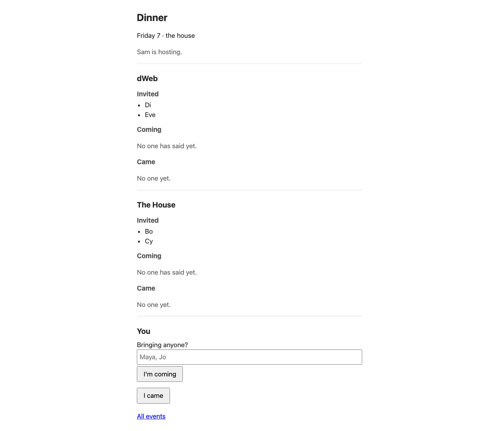
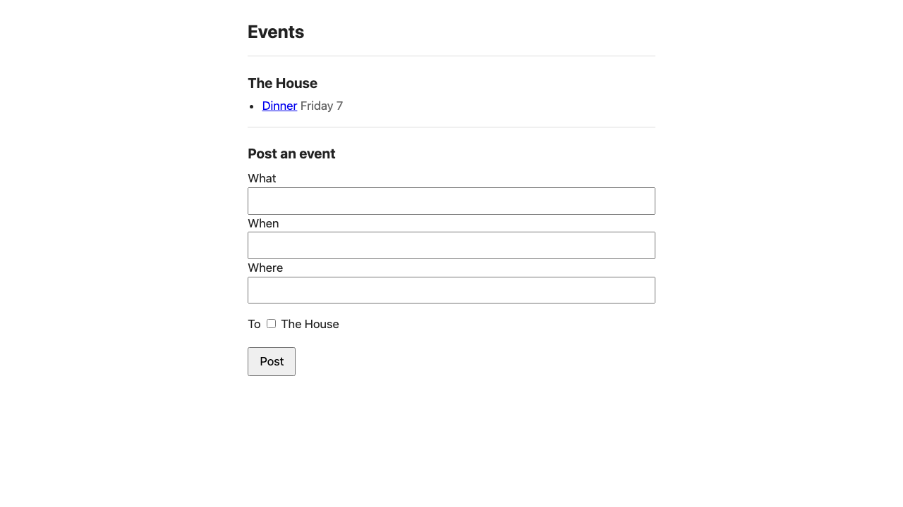
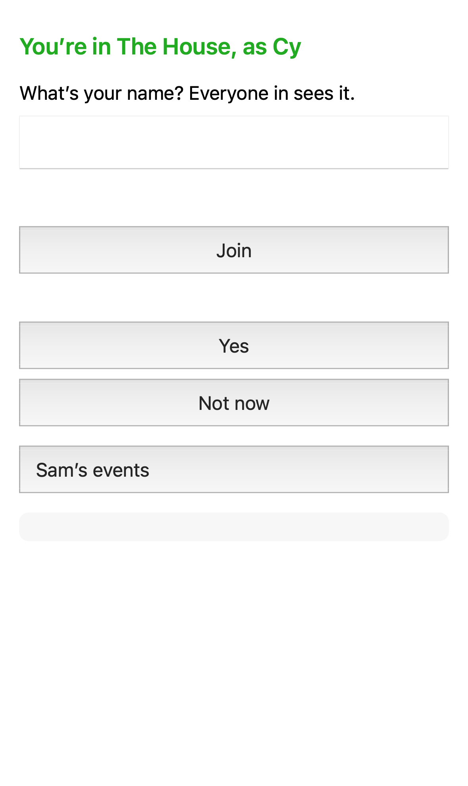
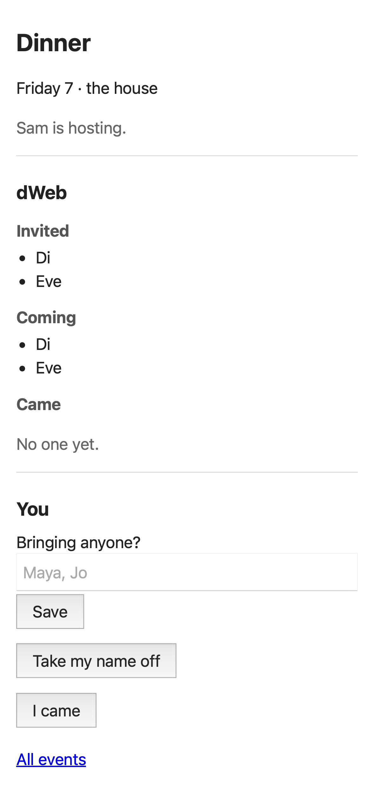
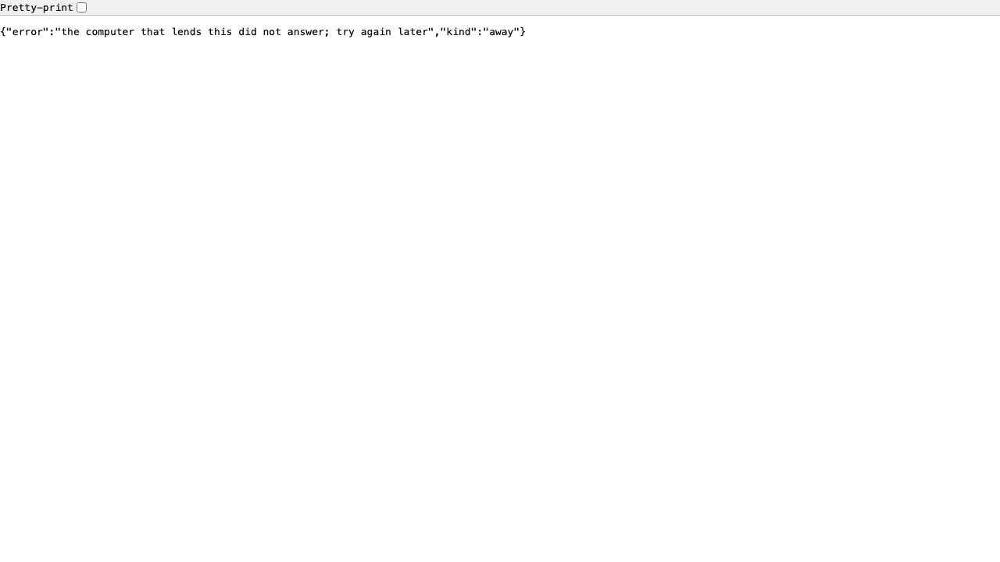
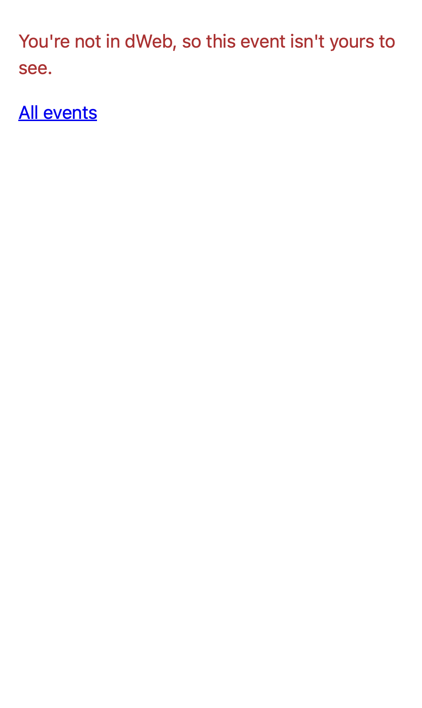

# Events — Sam's dinner: who was invited, and who came

> **Written 2026-10-14 for the launch story** (the operator: "so many
> stories start with an event, who was invited and who actually came").
> Every button below is one the run pressed, on one computer, every person
> a program (`runs/events/2026-10-14/README.md`, "the run" below). Its
> numbers are the clean take's (`data/summary.json`); its pictures are the
> shots take's, the same story again with every page saved and the way to
> the event walked from the home page and the phone's page
> (`data/shots/`, README "The shots take"). The bars at the end are the
> seat's proposal and the operator's to set. DESIGN §8 names this demo.

**Sam** hosts a dinner for people from two of Sam's groups: **The House**,
Sam's roommates, and **dWeb**, Sam's colleagues. Sam posts it once, to
both. **Bo** and **Fay** answer from their computers, **Cy** from her
phone, all three in The House; **Di** from his computer and **Eve** from
her phone, in dWeb. Bo brings a friend, **Maya**, who has nothing
installed and is in no group: she is a name Bo types. The next morning
Sam's page says, for each group, who was invited, who said they were
coming, and who came. Nobody makes an account, and nothing anyone sees
says that someone declined.

You need what `start.md` gives each person: svrngs on each computer, a
home page there, and on a phone the group's page, opened from the group's
link once. Where a step says *paste this line in a terminal*: open
Terminal (in Applications, then Utilities), paste the line, and press
Enter.

## What this is

**Events is an app, not svrngs.** It is the reference app for an event
(svrn-docs `rings/current/EVENTS.md` §0, §5), in `apps/events/`: one way
to do it, with its makers' opinions, and someone else may build another
on the same pieces.

- **An event is a post in a group, and people answer it.** Three things
  are written in the group's shared history: the post, by whoever hosts;
  "I'm coming", optionally with guests' names, by each person for
  themselves; and "I came", by each person for themselves, or by the
  person who brought a guest, for that guest.
- **Who was invited is whoever is in the group.** No one keeps a list.
  The run decided "in the group now", not "in the group when it was
  posted": Fay joined after the post, and she could see it and answer
  (README, "What invited means").
- **Nothing records "no."** "Take my name off" takes back your own "I'm
  coming". No page says that anyone is not coming or did not come.
- **Events live in lasting groups.** No event makes a group. A dinner
  drawn from two groups is posted in each, and each group's history holds
  only its own people's answers. Only Sam, who hosts, sees both.

**What svrngs gives it, all built before it** (EVENTS.md §2): who is
asking, on every request, so the app needs no sign-in; the group's
history, which the app writes to and reads back on Sam's computer; who is
in each group; a lend, so Sam's computer offers the app to Sam's groups;
and a way to change your own answer later. svrngs's code holds no word of
the app's (`apps/events/nouns.txt`, `scripts/vocab_check.py`).

## Sam: lend the app and post the dinner

**1. Run the app, and lend it.** Today the app runs from a copy of svrngs
on Sam's computer, with Node.js installed. In a terminal, in that copy:

```
echo "{\"record\": \"$(cat ~/.svrngs/api)\", \"who\": \"x-svrngs-key\"}" > ~/events.json
node apps/events/server.mjs ~/events.json
```

The first writes the app's settings, as the run wrote them (`run.py`
`app`); the second prints the app's number, `{"port":65216,"store":"record"}`
in the run (`apps/events/server.mjs:316`). Leave that window open: the app
runs while it is. In a second terminal, with that number:

```
~/.local/bin/svrngs share 65216 --kind events --name events
```

It asks *"If events takes a password on each request, paste what it takes
in its Authorization header, then press Enter (Enter alone for none)"*.
Press **Enter**. It says:

```
Lent events (port 65216) to everyone in your groups, as many at once as want it. …
svrngs is running here already, so they can open it now.
`svrngs unshare events` stops lending it.
```

One lend reaches both groups: The House and dWeb each list it as
**Sam’s events**.

**2. Open it.** On Sam's home page, press **Open Sam’s events**, under
either group (the run opened the address that link opens, the one Sam's
computer lists for the lend, `home.js:90`). The app's page says
**Events**, each group with *"Nothing posted yet."*, and **Post an
event** below.


**3. Post the dinner, once, to both groups.** Type in **What**, **When**
and **Where** (the run: `Dinner`, `Friday 7`, `the house`), tick both
groups beside **To**, and press **Post**. The dinner's page opens (145 ms
in the run): *"Sam is hosting."*, then each group with its people under
**Invited**, *"No one has said yet."* under **Coming** and *"No one yet."*
under **Came**. Sam sees both groups; no one else will.



**4. Tell people where it is.** There is no link to send for the dinner
yet (the run's finding 3, "What svrngs lacked" below). Tell them however
you talk: *"It's under Sam's events."*

## Everyone else: say you're coming

**5. Bo, on a computer.** On Bo's home page, under The House, press
**Open Sam’s events**. The app lists **Dinner**, *Friday 7*, under The
House. Press **Dinner**.




Bo sees The House alone: its people, who is coming and who came. dWeb's
are not on his page.

**6. Bo says he's coming, and brings Maya.** Press **I'm coming**: Bo is
under **Coming** (77 ms in the run). Then, changing his mind, he types
`Maya` under *"Bringing anyone?"* and presses **Save**: Coming says
**Bo + Maya** (64 ms). Saving again changes it; **Take my name off**
takes it back.


**7. Cy, on a phone.** Cy opens the group's page in the browser she
joined with, with no link: it says *"You’re in The House, as Cy"* and
lists **Sam’s events** (0.7 s in the shots take). Tap it: the app's list
opens (1.0 s there), then tap **Dinner**, then **I'm coming** (198 ms).




**8. Di and Eve, in dWeb.** The same, on Di's computer and Eve's phone:
their page shows dWeb alone, Di and Eve under Invited. Each presses **I'm
coming** (70 ms and 208 ms).



**9. Eve changes her mind.** She presses **Take my name off**. Her name
leaves Coming, and she is back to only Invited. Nothing on any page says
she is not coming.


## At the dinner: say you came

**10. Each person presses I came.** Bo presses **I came**, and then
**Maya came**: only Bo's page offers it, since Bo brought her. Cy presses
**I came**; her page offers no "Maya came". Di presses **I came**: his
computer was asleep while Eve took her name off, and once it woke it held
everything it had missed within a second (854 ms).


**11. Fay joins The House after the post.** Bo makes a link to The House
(on his home page, `start.md` step 4; the run typed `svrngs link "The
House"`) and Fay joins by it. Fay's Sam’s events lists Dinner;
she opens it, sees herself under Invited, and presses **I'm coming**.


## The next morning: who was invited, and who came

**12. Sam opens the dinner.** One page, each group in its own part:

- **The House**: invited Bo, Cy, Fay; coming *Bo + Maya*, Cy, Fay; came
  Bo, Cy, *Maya, Bo's guest*.
- **dWeb**: invited Di, Eve; coming Di; came Di.

Eve is under Invited and nowhere else. Every computer holding each group
gives the same answers (README, prediction 7).


Bo, Cy and Fay see The House's part alone; Di and Eve see dWeb's alone.


## When something does not work

Each of these is something the run met, or words the app or svrngs says,
with what to do.

- **A page that says nothing for 30 seconds, then
  `{"error":"the computer that lends this did not answer; try again later","kind":"away"}`**
  on a computer, or *"The computer lending this did not answer. Try again
  later."* on a phone (30,019 ms and 30,024 ms in the run). Sam's computer
  is asleep or off, and the app runs there. Try again when it is on: in the
  run Bo's page held every answer 420 ms after Sam's svrngs started again.
  Nothing anyone said is lost; Bo's and Fay's computers hold it too.

  
- **"This group can't be read on this computer right now."** The app,
  on Sam's computer, could not read the group: svrngs is not running there
  while the app is. Start svrngs on Sam's computer (`start.md`, "The home
  page does not open").
- **"You're not in dWeb, so this event isn't yours to see."** (or The
  House). You opened the other group's address of the dinner. Open it from
  **Sam’s events** in your own group.

  
- **On a phone, a name box, Join, Yes and Not now above Sam’s events**,
  after you joined. A mistake of the group's page (`web/index.html:53`,
  start-run's finding). Leave them; tap **Sam’s events**.
- **No "Maya came" button.** Only the person who brought a guest says
  they came. Ask them.
- **The dinner opens on dWeb's part first**, after Sam presses Post. The
  app lands on whichever group the computer lists first (the run's finding
  5, `02-sam-1.png`); Sam's page holds both groups either way.
- **Sam’s events is not listed** on a home page or a phone's page. Sam's
  computer is asleep, or the app is not lent. A home page says it as
  *"Sam's computer did not answer, so what they lend is not listed."*
  (`crates/svrngs-node/src/home/home.js:95`); not met in the run.

## What svrngs lacked

Two things, svrngs's, each written for the operator in the run's
`NEEDS_HUMAN.md`; the app works around neither:

1. **A person waits 30 s to be told Sam's computer is asleep.** svrngs
   gives up dialling after 30 s; a shorter wait would say it sooner.
2. **No link for the dinner.** The app is not told the address it is lent
   at, so it cannot hand anyone a link that opens the dinner. People reach
   it through Sam’s events and the app's list, as steps 5 and 7 do.

And while Sam's computer sleeps no one reaches the dinner, though Bo's and
Fay's computers hold every answer: a second computer lending the app would
keep it up (README, finding 4); not run.

## The demo: bars, proposed

Gate (the seat's proposal, the operator's to set): **Sam**, with the app
lent, posts a dinner to two groups in one form within two minutes, typing
only what, when and where; **each person**, from their home page or
phone's page, says they're coming within one minute, typing nothing but a
guest's name; the next morning Sam reads, on one page, each group's
invited, coming and came, a guest by name beside the person who brought
them; no one reads another group's answers; no page shows anyone
declining or not coming; a guest's "came" said only by the person who
brought them; a person told Sam's computer is asleep within a time the
operator sets (`NEEDS_HUMAN.md` §1). Two things stand before a run with
people: a link to the dinner (`NEEDS_HUMAN.md` §2), and Sam's step 1,
which takes two terminals and a copy of svrngs, with nothing yet on the
home page to start the app.

The run, every person a program, one host, not a rate (AGENTS.md 7): the
post landed 145 ms after the press; computers' answers 64–89 ms, phones'
196–208 ms; a phone's dinner open 1,604 ms and 1,627 ms after its group's
page was opened at the dinner's address; Di's computer held what it missed 854 ms after waking;
told Sam's computer was asleep after 30,019 ms (failed, README 10b). The
machine's floor under each bar, never the bar.

**What each person is told, and nothing else.** Sam: "Post a dinner for
The House and dWeb, and see who came the next morning" and this document.
Everyone else: "Sam posted a dinner under Sam's events; say whether you're
coming, and that you came" and this document.

**What is watched.** A clock per person, from their first click to their
answer shown on their page; every place a person stopped, asked or typed
something this document does not say, noted; each bar above passed,
failed, could-not-judge or never-ran (AGENTS.md 6).

**After.** Write the record in `runs/events/<date>.json` before looking
at anything else, as `README.md` has it.

## Running the story on one computer

For whoever runs the demo, not for its people: the run played everyone on
one computer, each computer a home folder of its own, the phones WebKit as
an iPhone. From a copy of svrngs, with the browsers installed
(`npm ci --prefix web && npx --prefix web playwright install chromium webkit`):

```
W=/tmp/events-run python3 demo/runs/events/2026-10-14/run.py
python3 demo/runs/events/2026-10-14/judge.py demo/runs/events/2026-10-14/data/summary.json
```

`SHOTS=1` before the first saves every page in `data/shots/`.
