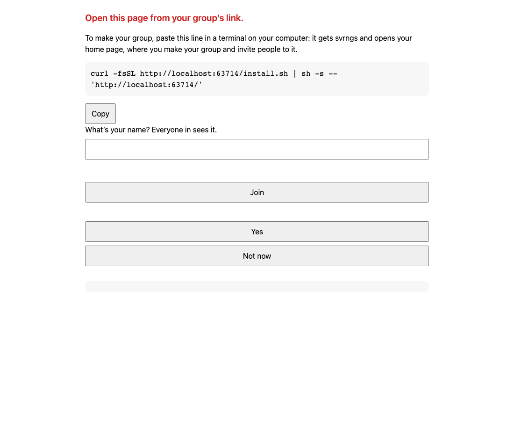
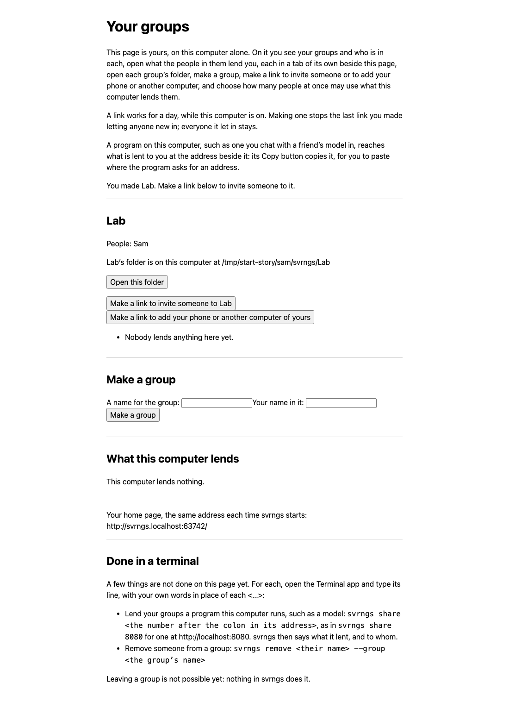
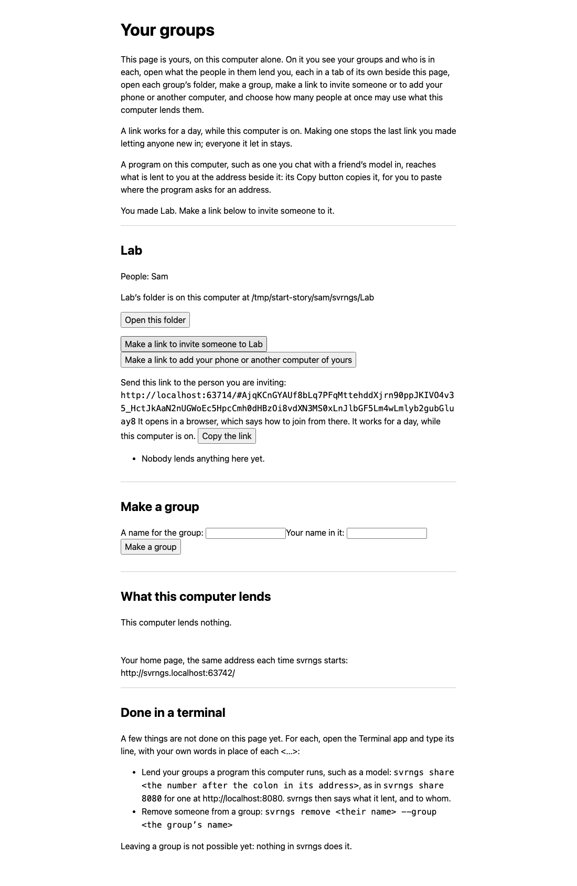
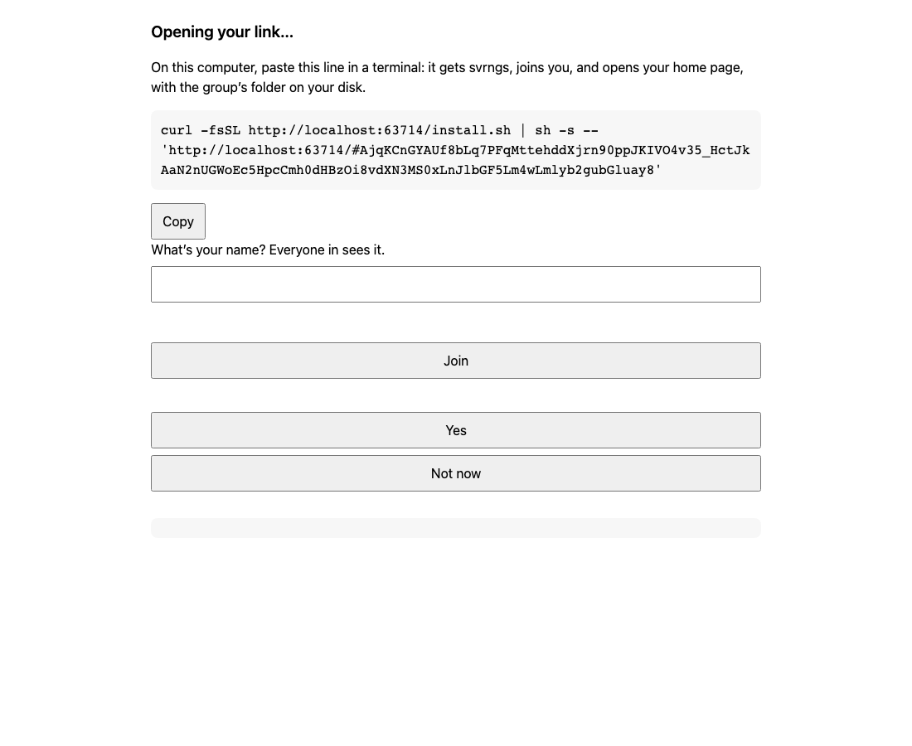
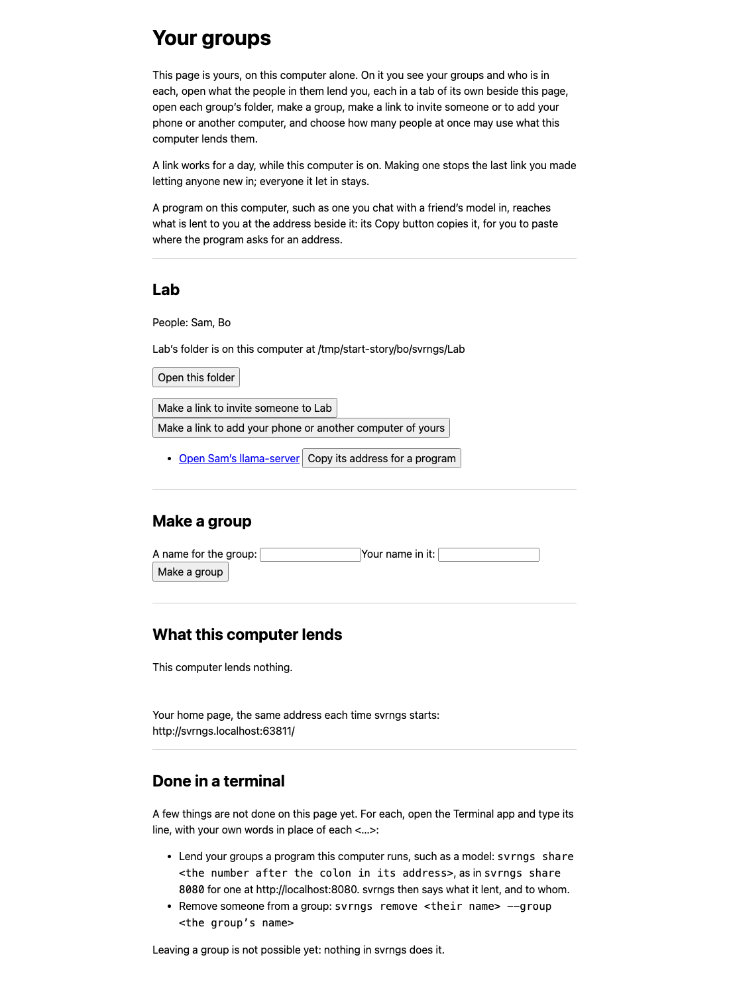
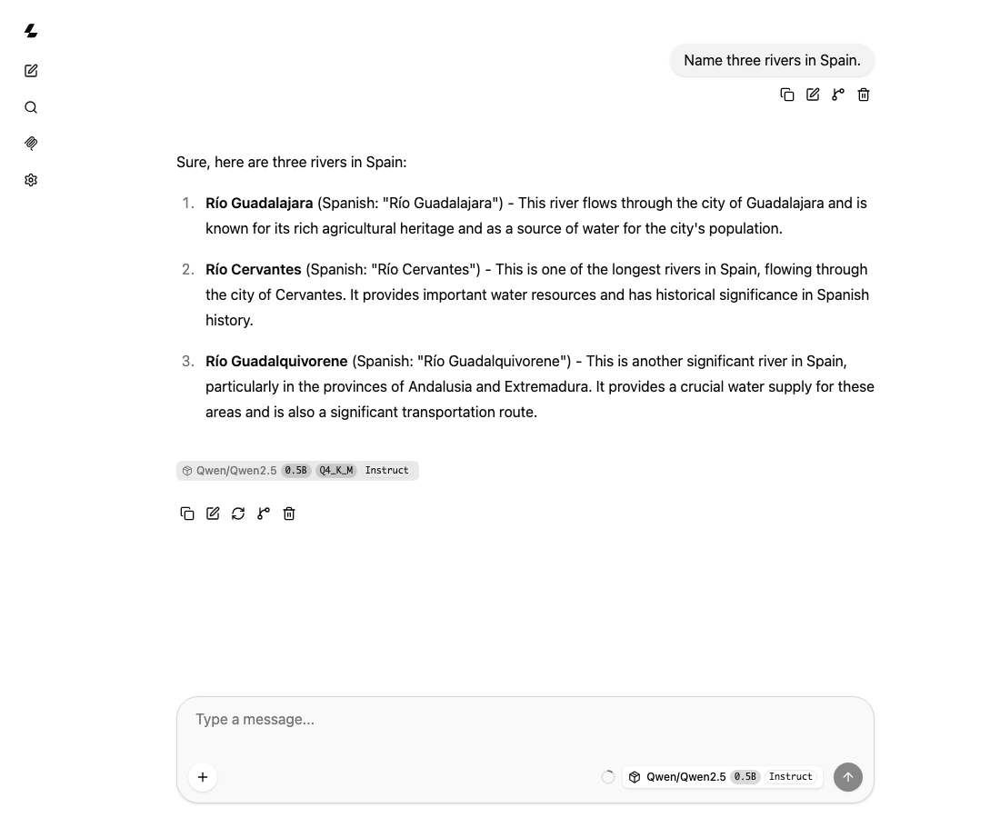

# Start — a friend lends their model, and the group uses it

> **Written 2026-10-13 for anyone getting started** (the operator: "nail
> down the svrn / llama-server on svrngs story and make it part of an early
> demo document for anyone getting started"). Every line to type and every
> button below is one the story's run typed or pressed, on one computer,
> every person a program (`runs/start/2026-10-13-story/README.md`, "the
> run" below); each picture is that run's. The bars at the end are the
> seat's proposal and the operator's to set. DESIGN §8 names this demo.

Two friends. **Sam** runs a model on their computer — llama-server, the
program that comes with llama.cpp — and wants their friends to use it.
**Bo** is one of those friends. At the end, Bo chats with Sam's model in a
browser on Bo's own computer, and a program on Bo's computer can ask it
too. Neither makes an account anywhere, and nothing asks either of them for
a password.

You need, on each computer, a browser and the Terminal app (in
Applications, then Utilities). Where a step says *paste this line in a
terminal*: open Terminal, paste the line, and press Enter. Nothing here
needs your password, and nothing here changes your computer's settings.
What svrngs puts on a computer stays in your own folder: the program in
`~/.local/bin`, its data in `~/.svrngs`, the group's folder in `~/svrngs`.

## Sam: make a group and lend the model

**1. llama-server is running.** Sam starts it as they always do. The run
started it with this line, which fetches a small model the first time:

```
llama-server -hf Qwen/Qwen2.5-0.5B-Instruct-GGUF:Q4_K_M --host 127.0.0.1 --port 18089 -c 4096 --parallel 2
```

When it works, `http://127.0.0.1:18089/` opens llama-server's own chat
page on Sam's computer. Remember the number after the last colon, 18089:
step 5 needs it. (Started with no `--port`, llama-server uses 8080.)

**2. Open the group's page, with no link.** In a browser, open
`https://group.svrnme.sh/` (until the operator publishes this build, the
page is served from a checkout: see "Before the page is published",
below). It says *"To make your group, paste this line in a terminal on
your computer"*, and shows the line with a **Copy** button:

```
curl -fsSL https://group.svrnme.sh/install.sh | sh -s -- 'https://group.svrnme.sh/'
```



Above the line the page says, in red, *"Open this page from your group’s
link."*, and below it shows a name box, **Join**, **Yes** and **Not now**.
Leave them: they are for a phone with a link, and show here by mistake
(the run's finding, its §4). Press **Copy**.

**3. Paste that line in a terminal.** Within a few seconds (1.4 s in the
run) it says:

```
Getting svrngs for this computer from https://group.svrnme.sh/get/svrngs-darwin-aarch64.tar.gz
Checked: svrngs-darwin-aarch64.tar.gz matches SHA256SUMS.
Installed svrngs in /Users/sam/.local/bin.
/Users/sam/.local/bin is not on your PATH, so to run svrngs yourself type /Users/sam/.local/bin/svrngs; nothing else needs it.
svrngs runs now, and whenever you log in (…/sh.svrnme.svrngs.plist).
Your home page, the same address each time svrngs starts: http://svrngs.localhost:63742/
```

and the browser opens that address, Sam's **home page**. The number in it
is this computer's own, and it stays the same each time svrngs starts:
bookmark it. With no group yet, it says *"This computer is in no group
yet. Make one below, …"*.

**4. Make the group, then a link.** Under **Make a group**, type a name
for the group in *"A name for the group"* (the run: `Lab`) and your own
name in *"Your name in it"* (`Sam`), and press **Make a group**. The page
says *"You made Lab. Make a link below to invite someone to it."*, and
where the group's folder is on this computer.



Press **Make a link to invite someone to Lab**. The page says *"Send this
link to the person you are inviting: …"* with **Copy the link**. Send it
to Bo however you two talk — a chat, a message, an email. It works for a
day, while Sam's computer is on.



**5. Lend the model.** At the bottom of the home page, **Done in a
terminal** says what is not done on the page yet. Lending is one of them.
In a terminal, type, with the number from step 1:

```
~/.local/bin/svrngs share 18089 --kind llama-server
```

`--kind llama-server` tells svrngs what is at that number, so it knows
what to keep back. It asks first:

```
If llama-server takes a password on each request, paste what it takes in its Authorization header, then press Enter (Enter alone for none):
```

Press **Enter**. (Only if Sam started llama-server with `--api-key`, paste
that key first.) Then it says:

```
Lent llama-server (port 18089) to everyone in your groups, as many at once as want it. …
They cannot open /slots, /v1/stream, … : svrngs keeps these back whenever a llama-server is lent, since they show one person's use of it to the others or change it for everyone.
svrngs is running here already, so they can open it now.
`svrngs unshare llama-server` stops lending it.
```

Reload the home page: it lists it under **What this computer
lends**.

Sam is done. Sam's computer has to be on, and llama-server running, for
Bo to use it.

## Bo: join from the link and ask the model

**6. Open Sam's link** in a browser on Bo's computer. Within a second it
says *"On this computer, paste this line in a terminal: it gets svrngs,
joins you, and opens your home page, with the group’s folder on your
disk."*, with the line and **Copy**. (The same name box and buttons show
below it as in step 2; leave them.)



**7. Paste that line in a terminal.** Within a few seconds (2.4 s in the
run) it says *"You're in Lab, as Bo."*, where Lab's folder is, and last
Bo's home page's address, and opens it. svrngs names Bo by the name the
computer knows them by; nothing to type.

**8. Open Sam's model.** On Bo's home page, under Lab, press **Open Sam’s
llama-server**. llama-server's chat page opens in a tab of its own. Type a
question in *"Type a message…"* (the run: `Name three rivers in Spain.`)
and press Enter. The answer appears as it is written (its first words
within a second in the run). The small model's answers are often wrong;
that is the model, not svrngs.




**9. A program on Bo's computer** — a chat app, an editor's assistant, a
script — can ask Sam's model too. Press **Copy its address for a
program**, beside **Open Sam’s llama-server**: the page says *"Copied:"*
and the address. Paste it where the program asks for an address (often
called its *base URL*, or *OpenAI-compatible API*). The address stays the
same when svrngs or the computer starts again. Many programs also ask for
a key: type anything, such as `none` — svrngs asks for none. The run's
program, in Python:

```python
import openai
client = openai.OpenAI(base_url="<the address you copied>", api_key="none")
for chunk in client.chat.completions.create(model="any", stream=True,
        messages=[{"role": "user", "content": "Name three rivers in Spain."}]):
    print(chunk.choices[0].delta.content or "", end="") if chunk.choices else None
```

## When something does not work

Each of these is something the run met, or words svrngs says, with what to
do.

- **"Open this page from your group’s link."**, in red, with a name box,
  **Join**, **Yes** and **Not now**, beside the line (steps 2 and 6). A
  mistake of the page's: the line is what you need. Copy it and go on.
- **`svrngs: command not found`**, or *"… is not on your PATH, so to run
  svrngs yourself type …"* after step 3 or 7. Type svrngs where it was put,
  `~/.local/bin/svrngs`, as in step 5.
- **`svrngs: say what is on port 18089: svrngs share 18089 --kind
  <kind>`** after `svrngs share 18089` alone. svrngs cannot tell
  llama-server by its number. Type the line again with `--kind
  llama-server` at its end.
- **The terminal waits after `svrngs share`**, its last line asking
  about a password. Press Enter.
- **On a phone, Sam's llama-server opens to "Error: gzip is not supported
  by this browser."** A phone cannot open llama-server's chat page through
  svrngs yet (the run's finding: llama-server answers a phone's page with
  nothing it can show). Use a computer: steps 6 to 8.
- **A program says "Missing credentials. Please pass an `api_key`"**
  (Python's `openai`). It wants a key before it asks anything. Give it any
  key, such as `none` (step 9).
- **A program gets `{"error":"this page answers only itself"}`.** It was
  given the home page's address. Give it the address **Copy its address
  for a program** copies instead (step 9).
- **"llama-server is lent to 2 people at once, and 2 are using it now: try
  again when one stops. …"** Sam chose how many people may use it at
  once, on Sam's home page. Try again in a minute, or ask Sam to let more
  in: Sam types a number beside llama-server under **What this computer
  lends** and presses **Let in this many**, or **Let everyone in**.
  (`crates/svrngs-node/src/door.rs`, `busy`; the run set 2 and saw the page
  say *"llama-server: up to 2 people at once, 0 using it now."*, but met
  no one refused.)
- **"llama-server is lent without /slots"** (or another of the names step
  5 lists). svrngs keeps those parts of llama-server back, so one person
  cannot see or change another's chats. llama-server's chat page asks for
  two of them each time it opens, `/tools` and `/v1/streams/lookup`, and
  in the run it showed nothing for it and answered.
- **Bo's home page does not list Sam's llama-server**, or says Sam's
  computer did not answer. Sam's computer is asleep or off, or svrngs is
  not running there. When Sam's computer is on again, reload the page.
- **The home page does not open** at its address. svrngs is not running.
  Log out and in again, or type `~/.local/bin/svrngs` in a terminal and
  leave that window open.

## Before the page is published

Until the operator publishes this build at `https://group.svrnme.sh/`,
the page there has no line for someone with no link (step 2). Whoever runs
this demo serves the page from a checkout of svrngs, on the computer Sam
and Bo can reach, as the run did:

```
scripts/build-web.sh --out /tmp/site && scripts/build-release.sh --out /tmp/site
node web/tests/serve.mjs /tmp/site
```

The second prints `port <n>`: the page is `http://localhost:<n>/`, in
place of `https://group.svrnme.sh/` in every step. It keeps serving while
that terminal is open. A page on `localhost` reaches only that computer,
so the two friends are on one computer: below.

## Trying both friends on one computer

The run played Sam and Bo on one computer, each with a home folder of
their own. One computer keeps one svrngs running at login, so Sam's is
moved into a terminal of its own before Bo's line runs (and before Sam
makes the group, so Lab's folder is put in Sam's home folder, not yours).

1. Terminal window 1, Sam's: `export HOME=/tmp/try/sam USER=Sam; mkdir -p
   $HOME; cd $HOME`, then steps 2 and 3. Then, still in window 1:

   ```
   launchctl bootout gui/$(id -u)/sh.svrnme.svrngs
   SVRNGS_DIR=$HOME/.svrngs $HOME/.local/bin/svrngs
   ```

   That stops the svrngs kept at login and runs Sam's here, at the same
   home page address. Leave the window open.
2. Steps 4 and 5, step 5 in window 2 after `export HOME=/tmp/try/sam
   USER=Sam`.
3. Terminal window 3, Bo's: `export HOME=/tmp/try/bo USER=Bo; mkdir -p
   $HOME; cd $HOME`, then steps 6 to 9. `USER=Bo` is what makes step 7
   say *"You're in Lab, as Bo."*: svrngs names a person by the computer
   account's name, and here both friends share yours. Without it, step 7
   names Bo with your name; nothing else changes.
4. When done: `launchctl bootout gui/$(id -u)/sh.svrnme.svrngs` (Bo's),
   Control-C in window 1 (Sam's), and `rm -rf /tmp/try`.

## The demo: bars, proposed

Gate (the seat's proposal, the operator's to set): **Sam**, with no link,
from the group's page to the model lent within five minutes, the founder's
line pasted and the share line typed the only lines, the group's name and
their own the only words; **Bo**, from Sam's link to an answer from Sam's
model in its chat page within three minutes on a computer, one line pasted
the only thing typed but the question; a program given the address the
home page copies answered, and answered again at that address after
svrngs starts again; nobody made an account, nothing asked anyone for a
key or a password but a program's own key field, answered with anything.
A phone from the link to an answer within two minutes waits on the
phone's page asking for gzip (above).

The run, every person a program, one host, not a rate (AGENTS.md 7): the
founder's line 1.4 s; the group made 0.3 s after the press; the share
0.008 s; Bo's line 2.4 s; the lend listed 0.3 s after Bo's page opened;
the answer's first words 0.03–0.1 s after sending; the program answered at
the copied address before and 1.4 s after a restart. The machine's floor
under each bar, never the bar.

**What each person is told, and nothing else.** Sam: "Lend your
llama-server to a group of yours, and invite Bo to it" and this document.
Bo: "Open the link Sam sent and ask Sam's model a question" and this
document.

**What is watched.** A clock per person, from their first click to Sam's
lend listed on Sam's home page, and to Bo's first answer; every place a
person stopped, asked or typed something this document does not say,
noted; each of the bars above passed, failed, could-not-judge or
never-ran (AGENTS.md 6).

**After.** Write the record in `runs/start/<date>.json` before looking at
anything else, as `README.md` has it.
