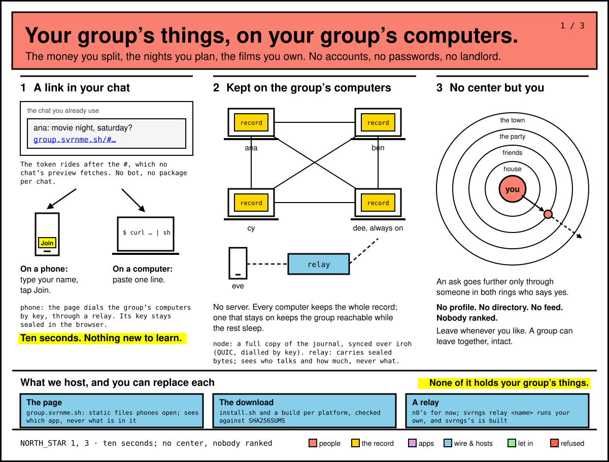
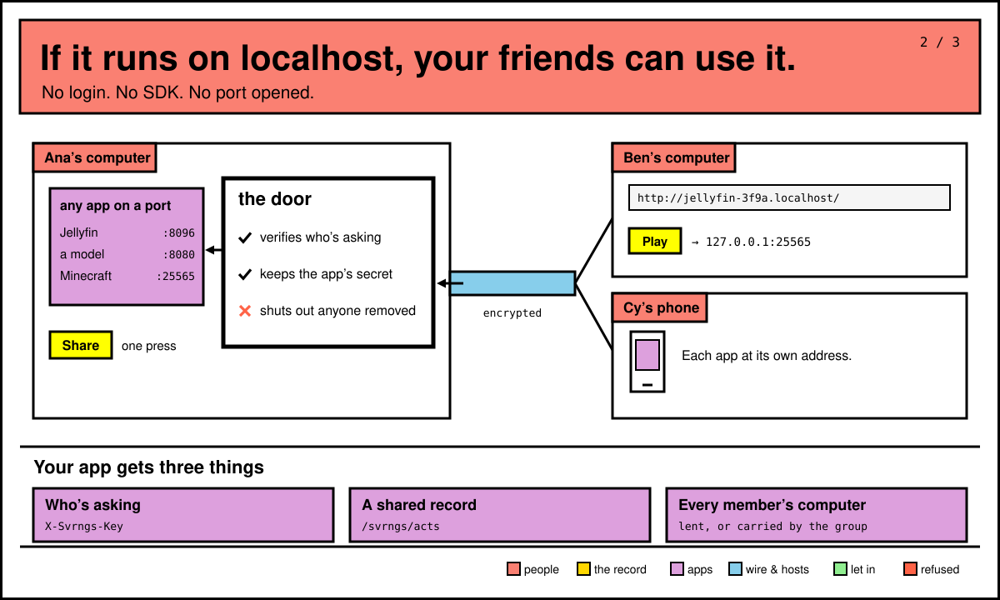
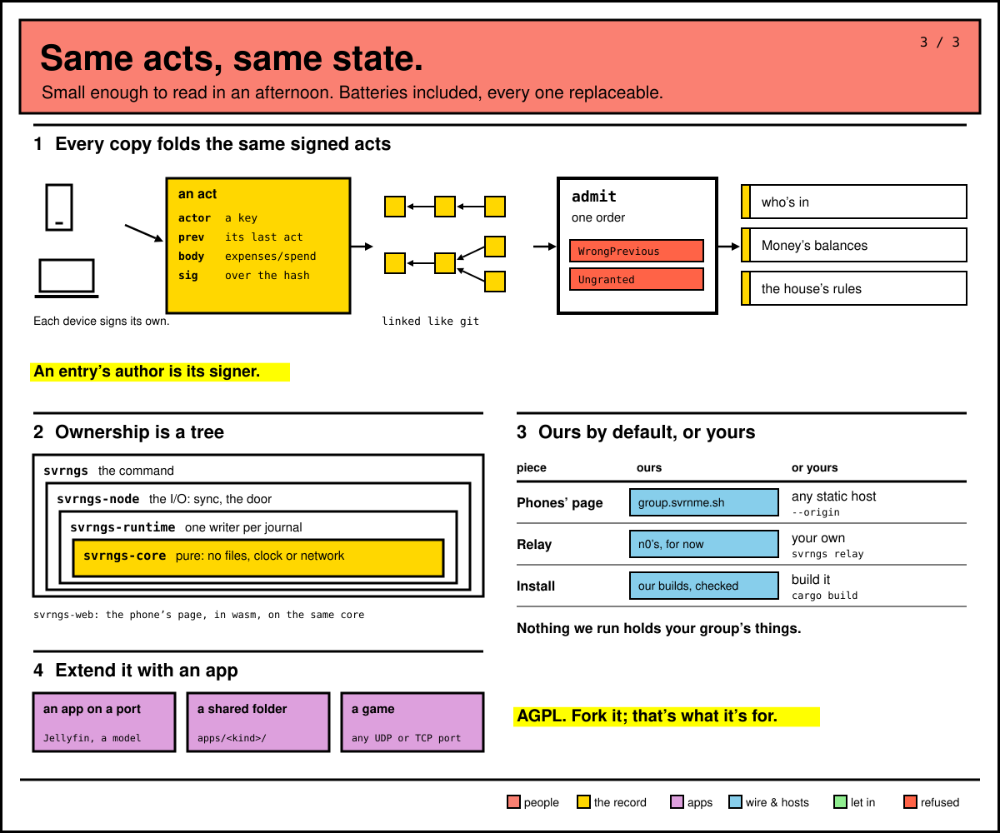

# svrngs at a glance

Three pictures, from what you get to how the code holds it. The big words
make the point. The small monospace ones are svrngs's own names, for when
you want to look something up.

**Your group's things, on your group's computers.** A link in your chat lets
you in from a phone or a computer in about ten seconds. Every member's
computer keeps the whole record. A relay carries sealed bytes for phones, and
sees who talks, never what. Reach goes outward only through someone who says
yes. More: [`README.md`](../README.md), and [`DESIGN.md`](DESIGN.md) §1.

**If it runs on localhost, your friends can use it.** Lend anything on a port
with one press. Your computer's door verifies who's asking, keeps the app's
secret, and shuts out anyone removed from the group. Your app gets three
things: who's asking, in its request headers; a record the group keeps; and
every member's computer. More: [`DESIGN.md`](DESIGN.md) §3.

**Same acts, same state.** Each device signs its own acts. Every copy puts
them in one order and folds them the same way, so who's in the group, Money's
balances and the house's rules agree everywhere. The code is a tree around
`svrngs-core`, which is pure. Each piece we run (the phones' page, a relay,
the builds) is a default, and you can run your own: see "Run it with nobody
in the middle" in [`README.md`](../README.md). You extend svrngs by adding an
app, never by changing the platform. More: [`DESIGN.md`](DESIGN.md) §5 and §6.

[`diagrams/v1/`](diagrams/v1/) holds a fuller first set, with more of the
mechanism on each picture. [`diagrams/README.md`](diagrams/README.md) says how
they're drawn.
