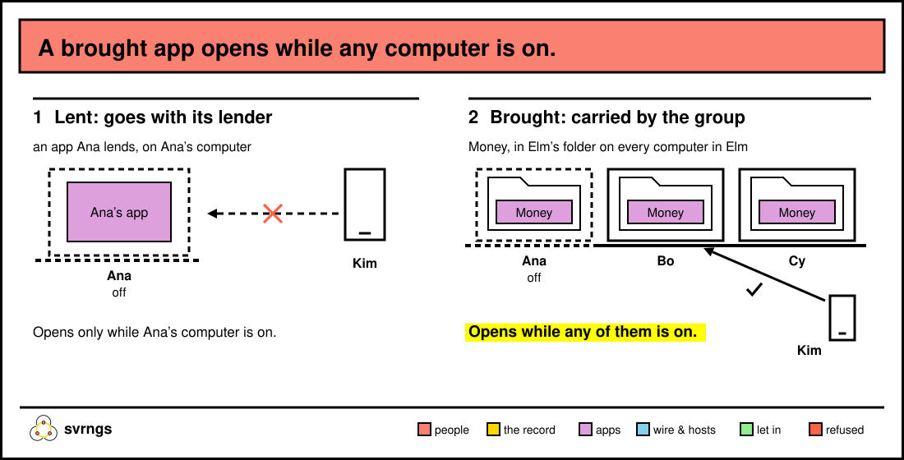
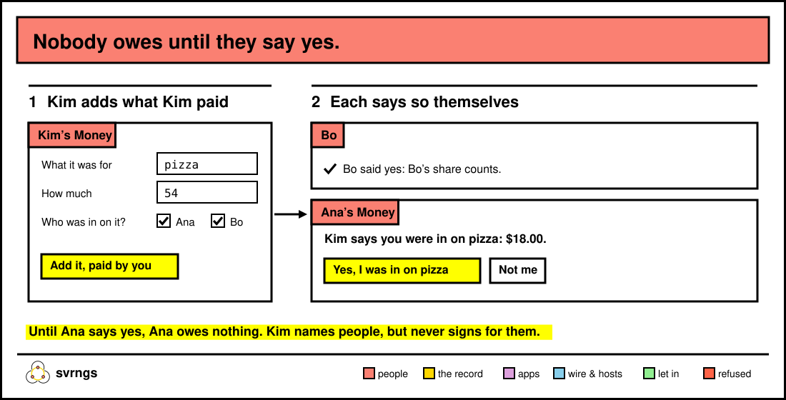

# The apps that come with svrngs

svrngs comes with a few small apps your group can use straight away: Money
for who owes whom, Events for nights out, and House rules for what your
house agrees. This page shows how to bring them to your group and what each
one does. Two more, the grapevine and the doc, are for people happy to run
something from a terminal.

## Bring an app to your group



On your home page, under your group, find **Bring things to the table**.
Each app is listed with a tick box and a line saying what it's for:

- **Money**: who owes whom, and for what.
- **Events**: the get-togethers people post, and who’s coming.
- **House rules**: the rules your house agrees, and how you agree them.

Tick the ones you want and press **Bring the ticked ones to Elm** (the
button names your group). The page says *"You brought Money to Elm:
everyone in it can open it in a few seconds."* Nothing is ticked to start
with; press the button with nothing ticked and it says *"Tick something to
bring first."*

The app then shows up in your group's list on everyone's home page and on
everyone's phone, as a link of its name, such as **Money**. Pressing that
link is how you open it. An app already brought says *"Money is on the
table."* and drops off the tick list.

The same list is on your group's page on a phone. Right after you join a
group, it's folded under **Bring more to Elm**.

A brought app lives in your group's folder on every computer in the group,
not on yours alone. So it keeps working when you're away: it opens while
any computer in your group is on.

**If someone changes an app.** Anyone in the group can change an app's
files. You keep the version you have until you say otherwise: your page
says *"1 app changed. See what’s new"*, and **Open the new version** moves
you to it.

## Money: split a bill



Kim pays $54.00 for Friday's pizza. Kim opens **Money**, and under **Add
what you paid** types `pizza` in **What it was for**, `54` in **How
much**, ticks Ana and Bo under **Who was in on it?**, and presses **Add it,
paid by you**.

Bo says yes first. Ana's Money page then asks: *"Kim says you were in on
pizza: $18.00."* with **Yes, I was in on pizza** and **Not me**. The share
it asks counts only the people who have said yes so far, plus you: had Bo
not answered yet, Ana would see $27.00. Nobody owes anything until they
say yes themselves. Kim can name people, but never signs for them.

What the page shows:

- At the top, your balance: *"You owe $18.00."*, *"You’re owed $36.00."* or
  *"You’re square with everyone."*
- **Who pays whom**: the payments that would settle everyone up. Beside a
  payment of yours there's a button, such as **Say you paid Kim $18.00**.
- **What people paid for**: each expense, who paid and who it's split
  between. If you weren't named but were there, press **Say you were in on
  pizza**.

Amounts are in dollars and cents, such as `12.50`. An expense splits evenly
between the payer and everyone who said they were in on it; a leftover cent
goes to one of them, the same on everyone's page. Only you can change what
you added. The page checks for new entries every 5 seconds, so a request to
you shows up while you look.

## Events: plan a night

Sam wants a games night, opens **Events** and, under **Post an event**,
fills in **What** (`Games night`), **When** (`Saturday 8pm`) and **Where**
(`Sam's`), then presses **Post it to your group**. Everyone in the group
sees it.

Bo opens Events and presses **Say you’re coming**. Bringing a friend? Bo
types the friend's name in **Bringing someone?** first. On the night, people press
**Say you came**. If Bo can't make it after all, **Say you’re not coming
after all** takes Bo's name off.

Each event shows *"Coming: …"* and *"Came: …"* by name. Nobody is ever
shown saying no: you're either coming, or not listed.

## House rules: agree how your house runs

Ana, Bo and Cy share a house. Ana brings **House rules**, and the first
time anyone opens it, it asks *"How does your house decide its rules?"*,
with three answers:

- **Anyone proposes a rule, and it holds after two days unless someone objects**
- **Most of you agree**
- **Everyone agrees**

Ana picks one and presses **Make this how your house decides**. That
choice is itself a rule your house can change later.

Then anyone writes a rule under **Propose a rule** (`Quiet after 10pm on
weeknights`) and presses **Propose this rule to everyone in your house**.
Everyone else sees it under **What’s proposed**, with **Agree** and
**Object**. Object asks *"Why do you object?"*, and you press **Send your
objection**: an objection always comes with a reason, shown to everyone.

When enough people agree, the rule moves to **Your house’s rules**. One
that's stopped goes under **Not adopted**, with the objection.

**Who has a say.** Everyone in the group, from the day they joined until the
day they left. "Most" and "everyone" count the people in the house when the
rule was proposed, so someone moving in later doesn't undo last month's
agreement. When someone leaves, the rest of you still decide.

To change how you decide, open **Change how your house decides** at the
bottom; the house agrees to that the same way it agrees to a rule.

House rules writes things down. It doesn't enforce them: if the house agrees
on quiet hours, nothing in svrngs stops a party at 11. Not yet: drawing
people by lot, taking turns, or letting a smaller group decide its own
corner.

## The grapevine: ask your friends' friends

Sam needs a tile saw on Saturday, and asks in the building's group. Jo is in
that group and in the block's group too, and presses **Carry to Waller
block**. Kim, in the block's group, sees *"A neighbour of Jo’s needs: tile
saw, Saturday — carried by Jo"* and presses **Offer**. Sam and Kim see each
other's names only once both have said **Yes**. Jo's computer passes their
messages on and can't read them.

People in a group a reply passes through can see that a sealed message went
by, its size and when, but never its words; the page says so on every
conversation.

The grapevine isn't on the tick list. Each person runs their own copy, on
their own computer, from a copy of the svrngs source with Node.js 20 or
later; it isn't lent to the group. `apps/grapevine/README.md` has the one
line to try it alone, and [the recorded walk-through](../../demo/grapevine.md)
runs it with three people.

## The doc: write something together

One person lends a document everyone writes at once. Each person's cursor
shows their name, and each paragraph says who last edited it. If the
lending computer stops answering, every page says that computer *"didn’t
answer"*, with *"Goodnight from Sam."*, and keeps what you write in your
browser, then joins it with everyone's when that computer answers again.

The doc isn't on the tick list either. You lend it from a copy of the svrngs
source, with svrngs running:

```
node apps/doc/server.mjs --port 4318 --keep ~/doc --svrngs ~/.svrngs/api & svrngs share 4318 --name doc --program doc --group <group> < /dev/null
```

(`svrngs` here is `~/.local/bin/svrngs` if your terminal doesn't find it.)
`--keep` is where the doc is saved. Everyone in your groups then finds
**doc** among what you lend. Write its first line before others open it.

## Make them your own

These apps are small starting points, not finished products. Each is a
handful of files you can read in an evening, meant to be copied and bent:
add a field to Money, a "bring" list to Events. [Build an app for your
group](build.md) shows how.
