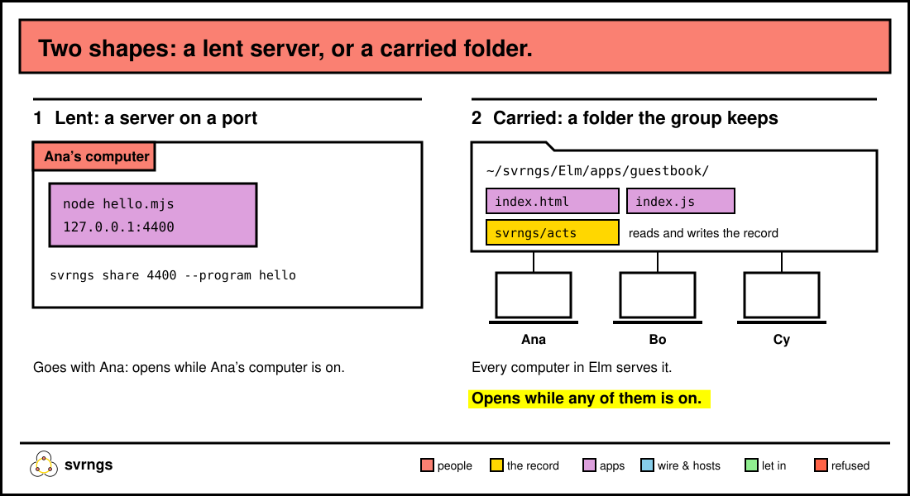

# Build an app for your group

If it runs on localhost, your group can use it. This page is for developers:
what svrngs hands your app, the two shapes an app can take, and a small
working example of each. [`docs/DESIGN.md`](../DESIGN.md) §3, "What an app
gets", is the whole surface; this page is the part you need first.

On this page: [what your app gets](#what-your-app-gets) ·
[a lent server](#shape-one-lend-a-server-on-a-port) ·
[a carried folder](#shape-two-a-folder-the-group-carries) ·
[asking for a yes](#ask-for-a-yes-before-another-app-uses-yours) ·
[sign in with svrngs](#sign-people-in-with-svrngs-openid-connect) ·
[svrngs's answers](#telling-svrngss-answer-from-your-apps) ·
[apps to copy](#copy-one-to-start).



## What your app gets


Three things, and no login, SDK or bundle:

1. **Who's asking, verified.** Every request that comes through svrngs
   carries headers svrngs sets. Any `x-svrngs-*` header the browser sent is
   stripped first, so these can't be forged from outside.
2. **A record the whole group keeps.** Entries your app writes are kept on
   every computer in the group, so they outlive the computer your app runs on.
3. **Reach.** Everyone in the group opens your app from their own computer
   or phone, through svrngs, wherever they are.

The headers:

| Header | What it is | Use it to |
|---|---|---|
| `x-svrngs-key` | the person, by their first key in the group; the same from all their devices | **key** anything that's theirs |
| `x-svrngs-person` | their name, as the group knows it; two people can share one | **show** who they are |
| `x-svrngs-user` | an account name, their name in ASCII plus 16 hex of their key, e.g. `Ana-3f9c0a1b2c3d4e5f` | name an account in an app that makes accounts |
| `x-svrngs-device` | the device asking | tell one person's devices apart |
| `x-svrngs-label`, `x-svrngs-pages` | where your app is lent, and each group's page | write a link into your app |

Key on `x-svrngs-key`, show `x-svrngs-person`. Never key on the name. A
guest arrives as `Sam (Kim's guest)`, with a key of their own and an
`x-svrngs-user` ending in `.guest`. svrngs writes the name as UTF-8 bytes;
in Node, read it with `Buffer.from(value, 'latin1').toString('utf8')`.

## Shape one: lend a server on a port

Your app is a server on your computer, and you lend it. It goes with you:
it opens while your computer is on.

Here's `hello.mjs`. It greets each person by name and counts their visits:

```js
// hello.mjs: greets whoever opens it, and counts their visits.
import http from 'node:http';

const visits = new Map(); // x-svrngs-key -> visits, kept while it runs

// svrngs writes the name as UTF-8; Node reads header bytes as latin1.
const told = (req, name) => {
  const v = req.headers[name];
  return v ? Buffer.from(v, 'latin1').toString('utf8') : null;
};
const esc = (s) => s.replace(/[&<>"']/g, (c) => `&#${c.charCodeAt(0)};`);

http.createServer((req, res) => {
  const key = req.headers['x-svrngs-key'];
  const person = told(req, 'x-svrngs-person');
  if (req.url !== '/') return res.writeHead(404).end();
  if (!key || !person) return res.writeHead(403).end('Open this through svrngs.\n');
  const n = (visits.get(key) ?? 0) + 1;
  visits.set(key, n);
  res.writeHead(200, { 'content-type': 'text/html; charset=utf-8' });
  res.end(`<!doctype html><meta charset="utf-8"><title>Hello</title>
<h1>Hello, ${esc(person)}</h1><p>Visit number ${n} from you.</p>`);
}).listen(4400, '127.0.0.1', () => console.log('hello is on port 4400'));
```

Run it, and lend it, with svrngs running:

```
node hello.mjs &
~/.local/bin/svrngs share 4400 --program hello --group <group>
```

svrngs asks *"If hello takes a password on each request, paste what it
takes in its Authorization header, then press Enter (Enter alone for
none)"*. Press Enter. It says *"You lend hello (port 4400) to everyone in
your groups, …"*. Bo and Cy now see **Ana’s hello** in the group's list;
Bo opens it and reads *"Hello, Bo"*. `svrngs unshare hello` stops lending
it. [Lend anything on a port](lend.md) covers the rest of `share`'s options.

Bind to `127.0.0.1`, as above. Anything else on your computer can still
reach the port directly and type its own headers, the same as any localhost
service.

### Keep it in the group's record

The visit count above lives in memory. To keep something with the group,
use the record.

**Write as the person asking.** Your answer names the entries in an
`x-svrngs-append` header: a JSON array of `{"group": "<group id>", "op":
{"kind": "...", ...}}`. The asker's own computer or phone signs each one as
them, before the page sees your answer; the header never reaches the
browser. svrngs files each under your lend's program, so `--program hello` writes
`hello/visit` for an `op` whose `kind` is `visit`. A header carries ASCII only, so
escape anything else in the JSON as `\uXXXX`. If an entry can't be saved,
svrngs withholds your answer and tells the person why.

**Read** through your own computer's loopback API. Its address is in the
`api` file of svrngs's data folder (`~/.svrngs`, or `$SVRNGS_DIR`), and
every call shows the `token` file beside it:

```
curl -H "Authorization: Bearer $(cat ~/.svrngs/token)" "$(cat ~/.svrngs/api)/v1/groups"
curl -H "Authorization: Bearer $(cat ~/.svrngs/token)" "$(cat ~/.svrngs/api)/v1/rail/log?namespace=<group id>"
```

`/v1/groups` lists your groups by `id`; `/v1/rail/log` answers every app's
entries in the group as `ops` (yours are those whose `kind` begins
`hello/`), each with `id`, `ts_unix`, `person`, `person_key` and `payload`; `/v1/rail/people` lists who's in it. `apps/events/store.mjs`
reads all three in about 40 lines, and `apps/events/server.mjs` writes with
`x-svrngs-append`.

## Shape two: a folder the group carries

Your app is static files that the group carries. It stays with the group:
every computer in the group serves it, so it opens while any of them is on.
svrngs runs none of its code; the browser does.

A carried app is a folder `apps/<name>/` holding an `index.html`, inside a
folder your group shares, usually its own at `~/svrngs/<group>`. It reads
and writes its entries at `svrngs/acts`, at its own address. Here's a
guestbook. `~/svrngs/Elm/apps/guestbook/index.html`:

```html
<!doctype html>
<html lang="en">
<head>
<meta charset="utf-8">
<meta name="viewport" content="width=device-width, initial-scale=1">
<title>Guestbook</title>
<script type="module" src="index.js"></script>
</head>
<body>
<h1>Guestbook</h1>
<ul id="list"></ul>
<p><input id="words"> <button id="sign">Sign it</button></p>
<p id="said"></p>
</body>
</html>
```

And `index.js` beside it:

```js
// A guestbook the group carries: each note is one of this app's acts.
const ACTS = 'svrngs/acts';
const $ = (id) => document.getElementById(id);
const say = (words) => { $('said').textContent = words; };

async function show() {
  const r = await fetch(ACTS);
  const read = await r.json().catch(() => ({}));
  if (!r.ok) return say(`Can't read the guestbook: ${read.error ?? r.status}`);
  const notes = read.ops.filter((o) => o.payload?.kind === 'note' && !o.voided);
  $('list').replaceChildren(...notes.map((o) => {
    const li = document.createElement('li');
    li.textContent = `${o.person}: ${o.payload.words}`;
    return li;
  }));
}

$('sign').onclick = async () => {
  const words = $('words').value.trim();
  if (!words) return;
  const body = JSON.stringify({ op: { kind: 'note', words } });
  const w = await fetch(ACTS, { method: 'POST', headers: { 'content-type': 'application/json' }, body });
  if (!w.ok) return say(`Not saved: ${(await w.json().catch(() => ({}))).error ?? w.status}`);
  $('words').value = '';
  say('');
  show();
};

show();
setInterval(show, 5000);
```

Save both, and within seconds **guestbook** appears in the group's list on
everyone's home page and phone (a `-` in the folder name shows as a space).

What `svrngs/acts` gives you:

- **`GET`** answers your app's own entries as `ops`, with `kind` as you
  wrote it, plus `you` and `you_key` (who's asking), `group`, `people`
  (names), and `spans` (each person's time in the group: `person`,
  `person_key`, `joined`, `left`; null while svrngs is still settling who's
  in). Each entry has `id`, `ts_unix`, `person`, `person_key`, `payload`
  and `voided`. It answers every entry each time, so fold them all on each
  read.
- **`POST {"op": {...}}`** writes one entry as the person, signed on their
  own computer or phone. `op` needs a `kind`. **`POST {"corrects": "<id>",
  "op": {...}}`** replaces one of your app's entries; `"op": null` voids it.
  An entry is at most about 64 KiB, and an app writes up to 200 entries as
  one person at once, then one every 18 seconds, voids included, counted
  from the record. Past that, `POST` answers 429 with
  `x-svrngs-refused: limit`, a `Retry-After` in seconds, and words that say
  the limit; your app writes again after that wait. The fastest we've
  recorded a person using an app is 20 entries in a minute, so only a loop
  reaches it, and that's what it's for: every member keeps every entry for
  good.

### Read your friends' apps

A carried app can read what your friends lend, such as their Jellyfin or
their llama-server. Name each program it reads in `reads.txt`, beside
`index.html`, apart by spaces or lines:

```
jellyfin
llama-server
```

Every program you lend has a name: `jellyfin`, `immich`, or whatever you call
your own. Apps find your program by that name, so type its real name, or the
name of the one it works like.

Your page can only connect to its own address, so it reaches each lend
there. `GET svrngs-reads` lists the lends of those programs in your group, each
with its `kind`, `name`, `lender` and `address`, like
`http://<your app>.localhost:<port>/svrngs-lend/<label>/`. Add the lend's
own path after it:

```js
const { lends } = await (await fetch('svrngs-reads')).json();
const films = lends.find((l) => l.kind === 'jellyfin');
const items = await (await fetch(`${films.address}Items?Recursive=true`)).json();
```

- **Each person says yes first.** The line beside your app's open says what
  it reads: *"Reads Sam’s and Bo’s jellyfin. They can see it’s you, and what
  it asks for."* Each lend can be unticked. Opening it there is the yes, for
  the lends it named. Before it, and after its Stop, svrngs refuses with
  `x-svrngs-refused: unasked`.
- **Only what you named, in your group.** Another program, or a lend in
  another group, is refused with `closed`.
- **A new lend waits for the next open.** A friend's new library, or a
  version that names another program, is refused `unasked` until the person opens
  your app from their home page, where the line says it's new. Until then
  `GET svrngs-reads` lists it under `new`, with its `kind`, `name` and
  `lender` and no address, so your page can say *"Bo's films are new. Open
  Movie Night from your home page to search them."* `new` is there only when
  something is new, and a phone never has it.
- **It only reads.** `GET` and `HEAD` go through, with the page's `Accept` and
  no other header, under the lender's readers' account if they keep one
  (`svrngs share --readers`) and with no credential of the lender's if not.
  Anything else is refused `closed`.
- **Reading or writing the record, not both.** Once someone has said yes to
  your app reading lends, a `POST` to `svrngs/acts` is refused for them, even
  after a Stop or in a later version. An app that writes to the record reads no
  lends.
- **About ten times a second.** Your app reads each lend up to 600 times at
  once as one person, then ten times a second. Past that, svrngs answers 429 with
  `x-svrngs-refused: limit`, a `Retry-After` in seconds, and words that say
  why. Movie Night reads each library once a search, so only a loop or a
  timer reaches it, and that's what it's for: a friend's computer answers
  every read.
- **Data only.** Your page gets `application/json`, `text/plain`, or a JPEG,
  PNG or WebP image, with its status and none of the lend's
  other headers. Any other type is refused `closed`.

If `reads.txt` names a word that isn't a program's name (letters, digits, `-` and `_`),
your app is left off the list until it's fixed.

Rules for carried pages:

- **Load nothing from elsewhere.** Every answer carries a policy that lets
  the page load from and connect to its own address only: no CDN, no
  inline `<script>` (inline styles are fine), no camera, microphone or
  location. Put every script in a file beside `index.html`.
- **Your app reads and corrects only its own entries.** Correcting another
  app's is refused: *"an app corrects only its own acts"*. Within your app,
  `voided` is set whoever made the correction; Money and Events count a
  correction only from the entry's own author (`voids` in `expenses.js`).
- **New versions wait for each person's yes.** Once brought, a change to
  the files runs for nobody until they press **Open the new version**.
  Test on a copy before you change the one your group uses.
- **Check what the record will accept before you send it**, as Money and
  Events do: each entry stays in the group's record for good, and a
  correction counts only from the person who wrote the entry.

## Ask for a yes before another app uses yours

Lend with `--ask` and your words, and no other app can use your lend for a
person until that person says yes:

```
svrngs share 4500 --program notes --ask "your notes" --group <group>
```

An app lent with `--reads notes` finds yours at `/svrngs-reads` on its own
address, with an `ask` address. It sends the person there, adding
`&back=<its path>`. Their home page, or their phone's group page, asks them,
and sends them back. Each yes is listed under **What acts as you**, with a
Stop. Your own pages are never held back. Without a yes, svrngs refuses the
app with `x-svrngs-refused: unasked`; after a stop, `stopped`.

## Sign people in with svrngs (OpenID Connect)

If your app already speaks OpenID Connect, add `--sign-in-with-svrngs`:

```
svrngs share 4500 --program myapp --sign-in-with-svrngs --group <group>
```

It prints an issuer, a client id and a secret for your app's settings
(*"Copy the secret now: it is not shown again."*). Each person is signed in
as themselves with nothing typed. The token says `sub` (their
`x-svrngs-key`), `name`, `preferred_username` (their `x-svrngs-user`) and
`groups`, `["member"]` or `["guest"]`. It is plain http on your computer,
signs with ES256, and carries no email address, because svrngs has none.

## Telling svrngs's answer from your app's

Whenever svrngs answers in your app's place, its answer carries
`x-svrngs-refused`, naming why: `away` (the lending computer didn't answer),
`closed`, `unlent`, `path`, `full`, `fault`, `unasked`, `stopped`, `limit`
(your app wrote its hour's entries, or read a lend faster than once a
second), and a few more. Your app's own answers never carry it. A program gets JSON,
`{"error": "...", "kind": "..."}`; a browser tab gets a page of the words.

The loopback API answers programs only: a call from a page in a browser is
refused, and so is one without the token.

## Copy one to start

- [`apps/expenses/`](../../apps/expenses/): Money, a carried app. The page
  is `index.html` and `index.js`; the arithmetic, one validator and its
  tests are in `expenses.js`.
- [`apps/events/`](../../apps/events/): Events, both shapes. `index.js` is
  the carried page; `server.mjs` and `store.mjs` are a lent server that
  writes with `x-svrngs-append`.

## If something goes wrong

- *"nothing answers on port 4400 on this computer: start it, then share
  it"*: start your server first.
- *"say which program is on port 4400: `svrngs share 4400 --program <name>` …"*: add
  `--program` with a name of your choosing.
- *"send this computer's token, which … holds, as `Authorization: Bearer
  <token>`: …"*: read the `token` file and send it.
- *"the record is served to this computer's apps, not to a page in a
  browser"*: call the loopback API from your server, not from page code.
- *"an act is JSON, {op} or {corrects, op}"*: your `POST` to `svrngs/acts`
  wasn't that shape.
- *"guestbook is writing faster than an app may here, about 200 entries an
  hour, because every member keeps each one for good. It can write again in
  18 seconds."*: your `POST`s to `svrngs/acts`, or `x-svrngs-append`
  entries, reached the limit. Look for a loop that writes. To save on every
  change, wait for a pause first.
- *"This app is reading films faster than an app may, about 600 times a
  minute, because Sam’s computer serves it. It can read again in 1 second.
  Read once and keep the answer, rather than on a timer."*: your app's reads
  of one lend reached the limit. Look for a loop or a timer that reads.
- *"Ana’s hello writes only its own part of the group’s record, so it was
  not saved."*, or *"… wrote in a group you and its lender are not both in,
  so it was not saved."*: an `x-svrngs-append` entry corrected something
  outside your app's own part, or named the wrong group.
