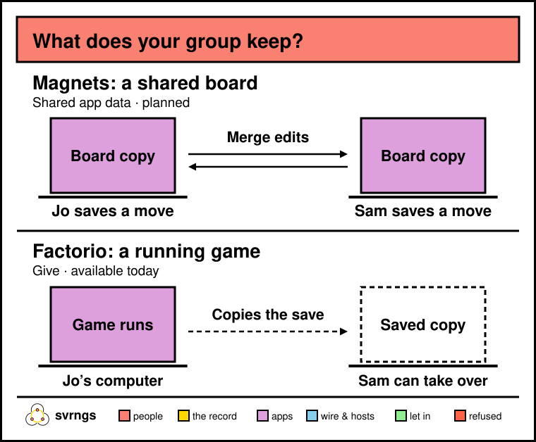

# Bring a folder or lend a program?

Your friends open either from the group page. The difference is **what your
group keeps: shared data, or a program that runs on one computer at a time.**

## Pick what you need

| If you want to… | Choose |
|---|---|
| Make a guestbook or a page that keeps a record of who said what | [Bring a folder app](build.md). Today, it can add entries to the group's record. |
| Make a shared board that people can edit on different computers, even when those computers can't reach each other | **Bring a folder with shared app data** (planned; see [the plan](../PLAN.md#1-order-of-work)). Each computer keeps a database copy. Edits merge when the computers meet. Any reachable computer with the board can serve it. |
| Let friends use something already running on your computer, like Jellyfin | [Lend the program](lend.md). Friends use it while your computer is on. |
| Let the group move or restore a supported server, like Factorio | [Keep it with Give](games.md#keep-a-game-for-the-group-with-give). One computer runs it; the others receive saved copies. If it goes away, someone can start the latest available copy, which may be missing recent changes. |

## The test for a builder

**If two computers can't reach each other, can both say “Saved”?** For
Magnets, yes: both moves can be saved and the boards can merge later. For
the last seat at dinner, no: if two people must never both be promised the
seat, have one running service decide. Give can move that service; the
service still owns the booking rule.

For platform work, queries, subscriptions and merging belong to shared app
data. Starting, stopping, saving copies and moving a process belong to
Give. Checking who can open an app belongs to svrngs. A shared board can
link to a game kept with Give while each keeps its own data.
