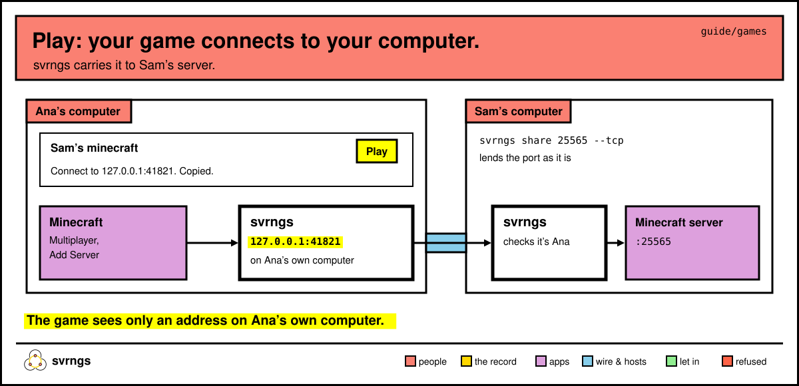
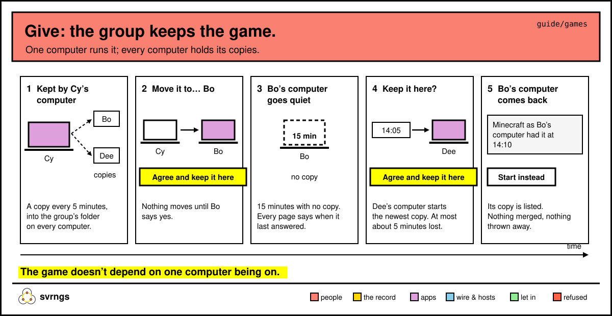

# Play games together

There are two ways to play with your group. Lend a game server you already
run on your computer, and friends join it from their home pages. Or use
Give to keep a game for the group, so it doesn't depend on one person's
computer being on.

`svrngs` below means `~/.local/bin/svrngs` if your terminal doesn't find it.

## Lend your Minecraft server

Sam runs Minecraft: Java Edition's server on their computer, on its usual
port, 25565, and lends it to the group:

```
~/.local/bin/svrngs share 25565 --tcp --program minecraft --name minecraft --group <group>
```

svrngs says *You lend minecraft (TCP port 25565) to everyone in your
groups, …*. `--tcp` lends the port as it is, not as a web page. A game port
needs `--program` to say which program it is; `--name` is what friends see. `--limit`
works here too, if only so many may play at once.

## Lend your Factorio game

Factorio speaks UDP on port 34197. Bo hosts a game from Factorio's
Multiplayer screen, then lends it with `--udp` in place of `--tcp`:

```
~/.local/bin/svrngs share 34197 --udp --program factorio --name factorio --group <group>
```

For any other game, use its port and whichever of the two it speaks.

## Join a friend's game

Ana opens the home page. Sam's row reads *Sam’s minecraft*, with
*Play opens it on this computer, for a program here to connect to.* and a
**Play** button.



1. Ana presses **Play**. The row now says *Connect to 127.0.0.1:41821.
   Copied.* (the number will differ), with **Stop**.
2. In Minecraft, Ana picks Multiplayer, then Add Server, pastes the address,
   and joins.

For Factorio it's Multiplayer, then Connect to address, and paste.

The address stays the same each time for that lend, so the game's saved
server keeps working. Press **Play** again after a restart if it's off.

**While Play is on, any program on your computer can reach the game as
you.** So it's listed on your home page under **What acts as you**, in
**Open to programs on this computer**, as *Open on this computer:
minecraft (Sam’s), while Play is on.*, with its own **Stop**. Nothing
listens once it's off.

To stop lending, Sam runs `svrngs unshare minecraft`.

Some things to know:

- Each player needs their own copy of the game, the same version as the
  server.
- Every player reaches the server from `127.0.0.1`, so the game's own bans
  by address can't tell players apart.
- Someone removed from the group is cut off within seconds.
- Not proven yet: a full session between two homes, and how a game plays
  when the two computers can't reach each other directly and svrngs passes
  it along in between. So far it has been played with both computers on
  one desk.

## Keep a game for the group, with Give

A lent server stops when Sam's computer sleeps. Give keeps a game on one of
your computers at a time and copies its world to the group, so anyone whose
computer can keep it can pick it up.



**Each computer that will keep games needs:**

- [Podman](https://podman.io/docs/installation), free, which runs the game
  in a container. Give's page links to it as **Get Podman**.
- Give's program. It's svrngs's own install line with `--give` after the
  address:

  ```
  curl -fsSL https://group.svrnme.sh/install.sh | sh -s -- 'https://group.svrnme.sh/' --give
  ```

  If your group's links are on a page of its own, use that page's address
  in both places. Give's page shows you the right line when your computer
  can't keep yet.
- For Factorio on a Mac with Apple silicon, Rosetta turned on in Podman
  Desktop's settings. Give's page says so if it's off.

The line keeps `give keep` running whenever you log in. Computers without
Podman still play, and still hold the copies.

**Once, anyone brings Give to the group:**

```
~/.local/bin/give page House
```

It says *Give is in House: everyone in it can open it in a few seconds.*
Everyone then sees **give** in the group's list on their home page.

## Start a game for the group

Cy opens **give**. Each game has a row. On Minecraft's row, Cy presses
**Start it for the group**. Give shows what the game's makers ask of
whoever runs it: *Minecraft's makers ask whoever runs a server to agree to
their terms.* with **Read them**. Cy reads, then presses **Agree and
start**. (Factorio asks nothing, so it starts right away.)

The row reads *Minecraft · kept by your computer*; on everyone else's page,
*kept by Cy’s computer*. Cy's computer lends it through svrngs, and
friends press **Play** on its row, as above.

Each player needs their own copy of the game in the version Give runs:
Minecraft: Java Edition 26.3, Factorio 2.1.23.

While Cy's computer keeps it, Give copies the world to the group every 5
minutes and whenever it stops, and keeps that computer's 3 newest copies.

## Move a game to another computer

Cy is going away for a week. On Minecraft's row Cy presses **Move it to…**,
then **Bo’s computer**. Bo's page says *Cy wants to move Minecraft to your
computer.*, with the makers' terms, **Agree and keep it here** and **Not
now**. (For a game with no terms the button is **Keep it here**.)

Nothing moves until Bo says yes. Then Cy's computer stops lending the game,
copies it one last time and stops it, and Bo's computer starts it from that
copy. Every row reads *kept by Bo’s computer*.

The game is now lent from Bo's computer, so friends press **Play** on its
new row and paste the address it gives.

## When the computer keeping it goes quiet

If the computer keeping a game goes 15 minutes without copying it,
everyone's page says when it last answered. Anyone whose computer can keep
it is offered the newest copy:

*Minecraft’s computer hasn’t answered since 14:10. You have a copy from
14:05. Keep it here?*

Dee presses **Agree and keep it here** (or **Keep it here**). Dee's computer
starts the game once the copy has fully arrived. At most about 5 minutes of
play is lost.

If that copy doesn't start, Dee's computer stops it and the page offers
the copy before it: *This copy didn’t start. Try the copy from 14:00?*

## When the old computer comes back

Bo's computer comes back on. It starts nothing and lends nothing. It copies
what it had to the group, and every page lists it, for example *Minecraft
as Bo’s computer had it at 14:10*, with **Start instead**. Anyone whose
computer can keep may start that copy in place of the current one, with
the same terms. Nothing is merged and nothing is thrown away.

## Keep something other than a game

Give can keep other apps than games. Each app on Give's shelf is a card:
the app's own `compose.yaml`, with an `x-svrngs` block naming its title, a
line about it, its port, what to keep, and what its makers ask. Minecraft and Factorio are the first two. To write
one, see [apps/give/README.md](../../apps/give/README.md).

---

More: [lend.md](lend.md) for lending anything else, [people.md](people.md)
for who's in your group. A step-by-step walk-through: [demo/give.md](../../demo/give.md).
