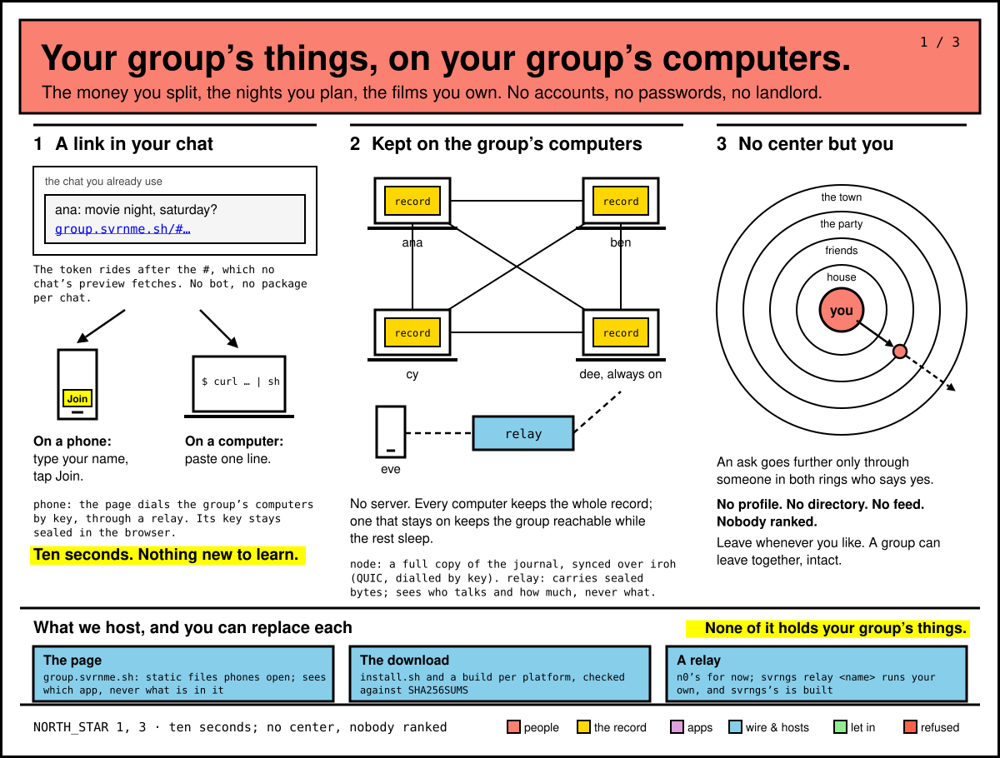
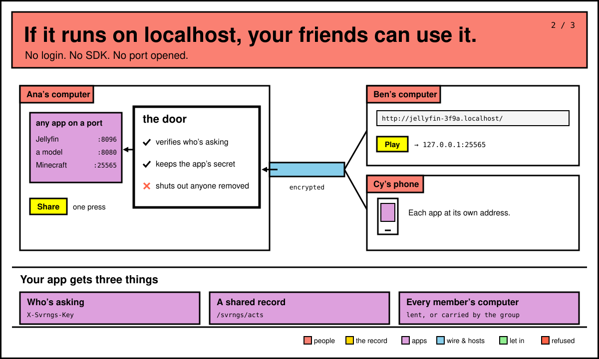
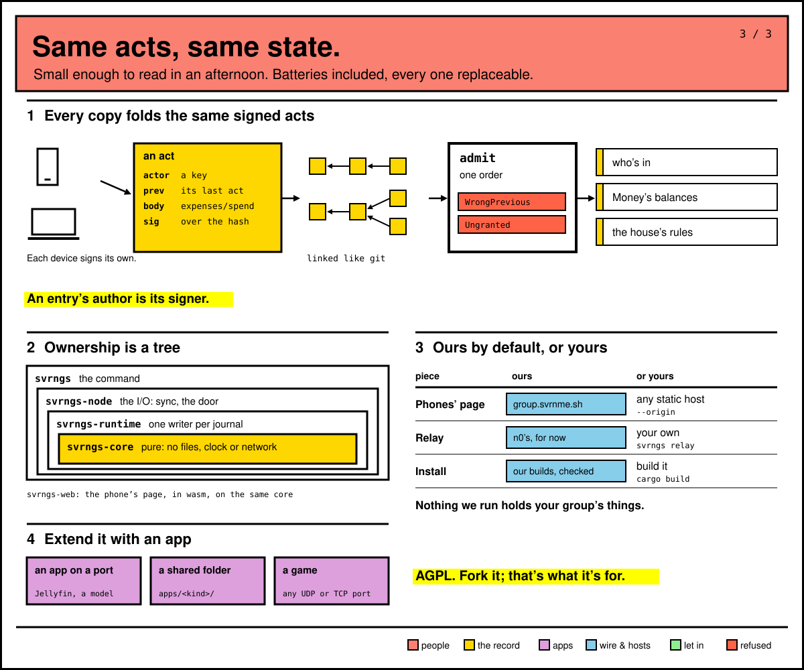

# How svrngs works

This page explains the few ideas behind svrngs, each with an example. Read
it once and the rest of the guide makes sense. To get going first, see
[Start](start.md).

## A group, and its link

A group is the people you already talk to in a chat: a house, a team, the
friends you plan with. Sam makes a group called Lab on their computer,
presses **Invite someone to Lab**, and drops the link in the chat. Bo opens
it, gives a name, and is in. So does Ana, from a phone.

- Nobody makes an account. The name you give is the name everyone in the
  group sees.
- A link works for a day, while the computer that made it is on. Making a
  new link stops the old one letting anyone new in; everyone it already
  let in stays.



## Your home page, and the group's page

There are two pages, and they do different jobs.

**Your home page** is on your own computer, at an address like
`http://svrngs.localhost:63742/`. The number is your computer's own and
stays the same each time svrngs starts, so bookmark it. Only your computer
opens it; nobody in your groups sees it. From it you make groups, invite
people, lend things and open what others lend. To open it again, open
svrngs from your Applications (on Linux, your applications menu).

**The group's page** is `https://group.svrnme.sh/`. It is what a link from
the chat opens. On a phone, it is where you join and where you open what
the group lends. On a computer, it shows the one line that installs svrngs
and joins you.

Example: Ana opens Sam's link on a phone, types `Ana`, taps **Join**, and
the page says *"You’re in Lab, as Ana"*, with a list of what's lent. Bo
opens the same link on a laptop, pastes the line it shows into Terminal,
and Bo's home page opens with Lab on it.

## Lending something that runs on your computer

Anything that answers at an address on your computer can be lent:
Jellyfin at `http://localhost:8096`, llama-server, Navidrome, Immich, a
game server. Sam runs Jellyfin. On the home page, under **Already running
here**, Sam presses **Look for programs running on this computer**, then
**Lend jellyfin to everyone in your groups**. Or, in a terminal:

```
svrngs share 8096 --kind jellyfin
```

What Bo and Ana see: a row **Sam’s jellyfin** in Lab's list. On Bo's
computer it opens in a tab of its own; on Ana's phone it opens at an
address of its own under `group.svrnme.sh`. Jellyfin asks each of them to
sign in once with an account Sam makes them. Some apps, such as
Navidrome, let each person straight in as themselves, once Sam sets one
thing in them.

A lend goes to everyone in every group your computer is in, not one group.
[Lend](lend.md) has the details: passwords, limits, stopping.

## How a lend reaches a friend, with no port opened

Sam opens no port and changes no router setting. svrngs on each computer
reaches out to the others over an encrypted connection. When two
computers can't meet directly, and always for a phone, a server in the
middle passes the bytes along sealed: it sees which computers talk and how
much, never what they say.

When Bo asks for Sam's jellyfin, Sam's computer checks that it is Bo, and
that Bo is in a group with Sam, before it answers. Then it tells Jellyfin
who is asking. Anyone else gets nothing. If Sam's Jellyfin needs a
password, Sam's computer adds it; Bo never receives it. Someone removed
from the group is shut out at their next request.



## The group's record, kept on every computer

What the group keeps together lives on its people's own computers: who is
in the group, and what Money, Events and House rules hold. Every computer
in the group keeps a whole copy. There is no server with the master copy.



Example: Ana writes down a $60 pizza in Money, from a phone. It reaches Sam's,
Bo's and Cy's computers. Later Sam's laptop dies. Bo's and Cy's still have
everything, Money still opens, and the group goes on.

Each group also has a folder, `~/svrngs/Lab` on each computer. What anyone
in Lab puts there reaches everyone else's. See [Folders](folders.md).

## Phones and computers

A phone joins in its browser and opens what the group lends. It can use
Money, Events and House rules, and bring them to the group. It can't lend
anything or keep the record: a computer does that, with svrngs running on
it.

A phone reaches the group through whichever computer in it answers first,
and says whose: *"You’re in Lab, as Ana, through Cy’s computer"*. If every
computer in the group is off, the phone can't reach anything until one is
on again.

On an iPhone, add the group's page to the Home Screen first and join from
there. Safari can forget a site, and you with it; a Home Screen app keeps
its own storage. [Start](start.md) shows how.

## What's ours, and who sees what

Your group's things live on your group's computers. We run three things,
and you can replace each ([README](../../README.md), "What we host, and
why"):

- **The page**, `group.svrnme.sh`: static files. It sees which app's
  address a phone opens, never what's in it.
- **The download** the install line fetches, checked against the
  release's list before it installs.
- **The servers that pass sealed bytes** between computers, run for now by
  n0, the makers of iroh. They see which computers talk and how much,
  never what.

| What | Who sees it |
|---|---|
| Your home page | You, on that computer. Nobody else. |
| What you lend | Everyone in every group your computer is in, while you lend it. |
| The group's record (Money, Events, who's in) | Everyone in the group. |
| Your name | Everyone in the group, and each app you open. |
| A guest | What you lend, for up to 48 hours. Never the group's record. See [People](people.md). |

Your home page lists, under **What acts as you**, every app and device that
can do something as you, each with its Stop.

## When someone's computer is asleep

What a computer lends is asked of it each time, never remembered. So when
Sam's lid is closed, Bo's home page says *"Sam's computer did not answer,
so what they lend is not listed."*, and Sam's name is marked *did not
answer*. A bookmark of Sam's jellyfin opens a page that says:

> ☾ Sam’s window is dark
>
> Sam’s computer didn’t answer, so this can’t open right now. It opens
> again once that computer answers.

Money, Events and House rules still open from any computer in the group
that's on. What you write while Sam sleeps reaches Sam's computer when it
wakes.

## Leaving

On your home page, under the group, press **Leave Lab**, or type `svrngs
leave Lab`. Lab stops reaching you, and what you lend stops reaching its
people. What you have of it stays on your computer, its folder too.
Rejoining needs a new invitation, and the computer you left from can't
rejoin yet: join again from a phone or another computer. If you're the
one who decides who is removed from Lab, hand that on first; [People](people.md)
says how.

## What it isn't

- No accounts and no passwords to svrngs itself.
- No profile, no feed, no directory of people, nobody ranked.
- No company server holding your group's things.
- You reach a new group only through someone already in it who sends you
  the link.

It's early: [RELEASES.md](../../RELEASES.md) says what works and what
doesn't yet.
