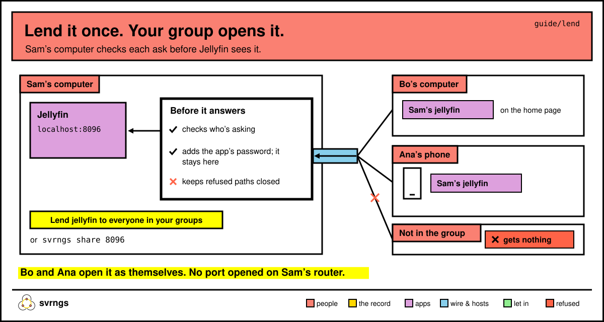

# Lend something you run

Anything running on your computer at an address like `http://localhost:8096` can be lent to your group. Your friends open it in their browser, as themselves, through your computer; anyone outside your groups gets nothing, and you open no port on your router. This page shows how, with Jellyfin, Navidrome and others as examples.



In the commands below, `svrngs` means `~/.local/bin/svrngs` if your terminal doesn't find it.

## Lend it from your home page

1. Start the program as you always do. Say Sam starts Jellyfin.
2. Open your home page (open svrngs from your Applications). Under **Already running here**, press **Look for programs running on this computer**. Looking takes a few seconds.
3. The page lists what it found, each at its address: *"jellyfin, at http://localhost:8096. It keeps its own accounts, so make each person one in it: …"*
4. Tick the groups who can open it, then press **Lend jellyfin to House** (the button names the groups you ticked).

The row then says *"You lent jellyfin, at http://localhost:8096: the groups you chose can open it now."*, and it shows under **What you lend**.

If svrngs doesn't know the program, the row says *"Something at http://localhost:5006. To lend it, give it a name and say what it is, each one word…"*. Fill in **Its name:** and **What it is:** (for example `actual` and `actual`), tick who can open it, then press **Lend it to House** (the button names the groups you ticked).

The home page never asks for a password. If the program wants one on every request, lend it from a terminal (below).

## Lend it from a terminal

```
svrngs share 8096 --group <group>
```

That's the port number from the program's address, and `--group` says who can open it: say it once for each group, by its name or the start of its id. With none, svrngs refuses and tells you this line; it never lends to all your groups. svrngs knows a few programs by their port: Jellyfin (8096), Navidrome (4533) and Calibre-Web (8083). For anything else, say what it is with `--kind`:

```
svrngs share 2283 --kind immich --group <group>
```

Without `--kind` on a port it doesn't know, svrngs says *"say what is on port 2283: `svrngs share 2283 --kind <kind>`, its own name if it is one svrngs knows: jellyfin, navidrome, calibre-web, llama-server"*. If nothing is running there, it says *"nothing answers on port 2283 on this computer: start it, then share it"*.

If svrngs isn't running yet, `share` starts it and says *"Leave this running; Ctrl-C stops it."* Usually it already runs, and `share` ends with *"svrngs is running here already, so they can open it now."*

## Lend Jellyfin

```
svrngs share 8096 --group <group>
```

Jellyfin keeps its own accounts, so svrngs asks no password and tells you how to make your friends one:

```
You lend jellyfin (port 8096) to the groups you chose, as many at once as want it. …
jellyfin asks each person to sign in once, with an account you make them. In jellyfin: your picture at the top right, then Dashboard, Users and +; give it a name and a password, tick the libraries they may watch, and Save. Then tell each person theirs.
`svrngs unshare jellyfin` stops lending it.
```

Make Bo and Ana an account each, send them their passwords, and each signs in once. To skip that step, see [Sign people in with svrngs](#sign-people-in-with-svrngs).

## Lend Navidrome, with nobody signing in

Navidrome can take each person's name from svrngs, so nobody types a password. Start Navidrome with these two settings in its environment:

```
ND_EXTAUTH_USERHEADER=X-Svrngs-User
ND_EXTAUTH_TRUSTEDSOURCES=127.0.0.1/32
```

then `svrngs share 4533 --group <group>`. Each friend who opens it is in as themselves.

## Lend Calibre-Web

`svrngs share 8083 --group <group>`. Like Navidrome, it can take each person from svrngs. In Calibre-Web: Admin, Edit Basic Configuration, Feature Configuration; tick Allow Reverse Proxy Authentication, set Reverse Proxy Header Name to `X-Svrngs-User`, and Save. svrngs hasn't yet checked whether Calibre-Web lets in a friend it has no account for.

## Lend Immich, Actual, or anything else

Say what it is in one word, and svrngs passes that word on as the app's kind:

```
svrngs share 2283 --kind immich --group <group>
svrngs share 5006 --kind actual --group <group>
```

svrngs asks whether it takes a password on each request (next section). Immich keeps its own accounts, so press Enter and make each friend an account in Immich. Actual asks everyone for the one server password you set.

## Lend something that takes a password on each request

For a kind it doesn't know, `share` asks:

```
If immich takes a password on each request, paste what it takes in its Authorization header, then press Enter (Enter alone for none):
```

Most apps with a sign-in page don't need this: press Enter. Paste something only if the program wants a header on every request, such as llama-server started with `--api-key abc123`: then paste `Bearer abc123`, the whole header value. What you type isn't shown. svrngs then says *"Its password stays on this computer; nobody you lend it to receives it."* Your friends never see it, but to the program they all arrive as that one password, so it can't tell them apart.

## Give it a name

```
svrngs share 8096 --name films --group <group>
```

Your friends see *"Sam’s films (jellyfin)"*. Without `--name`, the name is the kind: *"Sam’s jellyfin"*. A name is letters, digits, `-` and `_`.

## Let in only so many at once

```
svrngs share 8096 --limit 3 --group <group>
```

On your home page, under **What you lend**, type a number in **How many people at once:** and press **Let in this many**; **Let everyone in** takes the limit off. Someone counts as using it while a request of theirs is running and for 30 seconds after. The fourth person sees *"jellyfin is lent to 3 people at once, and 3 are using it now: try again when one stops. That number is the choice of the person who lends it, and they can change it."* With no limit, everyone in the groups you chose can use it at once.

## Keep part of it back

```
svrngs share 8000 --kind wiki --refuse /admin --refuse /settings --group <group>
```

Each path, and everything under it, stays closed to your friends: `/admin` closes `/admin` and `/admin/users`, but not `/administer`, however it's spelled. They see *"wiki is lent without /admin"*. Repeat `--refuse` for each path.

## Sign people in with svrngs

For an app that speaks OpenID Connect, such as Jellyfin with its SSO plugin, svrngs can sign each friend in as themselves, with nothing typed:

```
svrngs share 8096 --sign-in-with-svrngs --group <group>
```

Or press **Sign people in with svrngs** beside it under **What you lend**. Either way you get three things to copy into the app's own settings: *"choose OpenID Connect, and fill in: issuer http://127.0.0.1:…/oidc/jellyfin, client id …, client secret …"*, then *"It is plain http on this computer, not https; it signs tokens with ES256; and it tells the app no email address, because svrngs has none. Copy the secret now: it is not shown again."*

For Jellyfin: install Jellyfin's SSO plugin, add an OpenID provider with those three values, and in the plugin's settings allow plain http (`DisableHttps`) and turn off its endpoint check (`DoNotValidateEndpoints`). In Jellyfin's networking settings, set the known proxies (`KnownProxies`) to `127.0.0.1`. Then each friend who opens it from the group's list signs in with one press, on a computer or a phone, and two people watching at once stay apart.

## More options

- `--upload 40`: your computer's upload speed in Mbit/s, as a speed test shows it. svrngs tells each person's browser, and the app, their share of it. A person sees it only if the app shows it.
- `--ask "your notes"`: an app can use this lend only after the person it acts for says yes. They're asked *"Let Ana’s planner use Sam’s notes?"* on their own home page, with your words, **Yes** and **Not now**, and can stop it later.
- `--reads jellyfin`: for an app you lend that reads other lends. Its pages may open the Jellyfins your groups lend, as whoever opens the app. Beside it your friends read *"It also opens your friends’ jellyfin as you, and they can see what it asks."*
- `--readers`: for something other apps read, such as a Jellyfin that Movie Night searches. Make one account in it for your groups, and tick only what they may see. `share` asks for its name and password, signs in once, and keeps what it's given on this computer. Apps that read it then see what that account sees, and only look: anything else they send is refused before it reaches your computer's program, and they're told to ask you. Without `--readers`, an app that reads it sees what anyone who hasn't signed in sees. A friend who opens it themselves still signs in as themselves. Sharing it again without `--readers`, or `unshare`, forgets the account.

## Stop lending something

```
svrngs unshare films
```

It says *"You no longer lend films."* Or press **Stop lending** beside it on your home page.

## How your friends open it

- **On a computer:** on their home page, under your group, the table lists *"Sam’s films (jellyfin)"*. Clicking it opens it in a tab of its own.
- **On a phone:** on the group's page (the link they joined from, or the icon on their Home Screen), they tap *"Sam’s films (jellyfin)"*. It opens in that tab.
- **Bookmark it.** Every lend has an address that doesn't change. Below the group's list on the home page, each lend shows its address, `http://<…>.localhost:<port>/`, with *"Bookmark this."* On a computer that joined in a browser, the group's page shows one too.
- **Send it in the chat.** `#open=films@Sam` after your group's page opens Sam's films: `https://group.svrnme.sh/#open=films@Sam`. Added after a group link, it's `&open=films@Sam`: the link joins, then opens it.
- **Two people called Sam?** The name says when each joined: `films@Sam (joined 24 Oct)`. A name that matches nothing says *"Nothing in Lab goes by films@Sam now."*; one that matches two says which to pick from the list.

## What svrngs keeps back on its own

For some kinds, svrngs keeps back the parts that would show one person's use to the others, or change it for everyone, without you typing `--refuse`. `share` lists them: *"They cannot open /slots, …: svrngs keeps these back whenever a llama-server is lent…"*. Today llama-server is the only one; [models.md](models.md) says what each part is.

Game servers and anything else that speaks UDP or TCP rather than web pages are lent with `--udp` or `--tcp`: see [games.md](games.md).

## Good to know

- **Your computer has to be on**, with svrngs and the program running. When the computer doesn't answer, friends see *"Sam’s window is dark"*, and it opens again once it does. When the program isn't running, they're told *"Sam’s jellyfin is not answering now: try again later"*.
- **What acts as you.** On your home page, **What acts as you** lists everything that can act in your name: apps that open friends' things as you, what's open to your WiFi ([tv.md](tv.md)), game ports open with **Play**, and which of your devices can decide for you, with a button to stop or close each that can be stopped.
- **A lent program learns the name of whoever opens it.** Your friends' home pages say so: *"What you open knows your name."*
