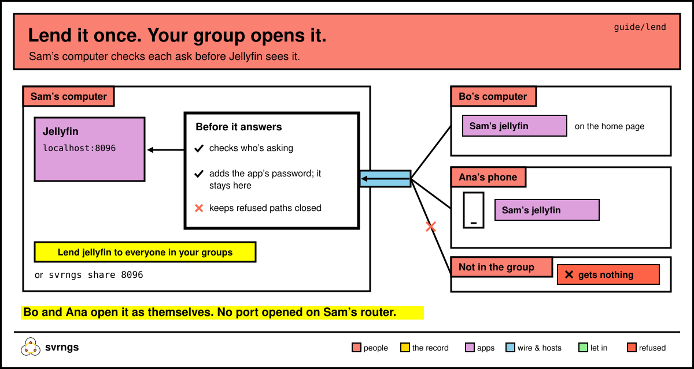

# Lend something you run

Anything running on your computer at an address like `http://localhost:8096` can be lent to your group. Your friends open it in their browser, as themselves, through your computer; anyone outside your groups gets nothing, and you open no port on your router. This page shows how, with Jellyfin, Navidrome and others as examples.



In the commands below, `svrngs` means `~/.local/bin/svrngs` if your terminal doesn't find it.

## Lend it from your home page

1. Start the program as you always do. Say Sam starts Jellyfin.
2. Open your home page (open svrngs from your Applications). Under **Already running here**, press **Look for programs running on this computer**. Looking takes a few seconds.
3. The page lists what it found, one line each: *"jellyfin, at localhost:8096"*. Press the line to open it. It says what the program needs first, such as *"It keeps its own accounts, so make each person one in it: …"*
4. Tick the groups who can open it, then press **Lend jellyfin to House** (the button names the groups you ticked).

The first press lends nothing yet: the row says who can use it and when, such as *"House can use it while it’s running."*, and the button becomes **Yes, lend it**. **Details** under it lists the parts svrngs keeps private. Press **Yes, lend it**: the row says *"Lent to House."*, and the lend opens under **What you lend**.

If svrngs doesn't know the program, its line names the program answering there and its address. Open it, fill in **Its name:** and **Which program:** (for example `actual` and `actual`), tick who can open it, then press **Lend it to House** (the button names the groups you ticked). For a program svrngs knows by its name, such as llama-server, both are filled in for you; change them if you like.

For a program apps may also send to, such as llama-server, the review adds *"Apps your friends open can also send it requests, each after that friend says yes."*, and **Details** lists where ([models.md](models.md#lend-your-llama-server)).

The home page asks for a password in two places: the account apps read through, in the next paragraph, and a header the program wants on each request, such as its API key (below). Each goes to this computer and nowhere else.

If apps read the program, as Movie Night reads Jellyfin, its line under **What you lend** opens to say *"Apps can't read your jellyfin yet. To let them, make one account for your group."* Unfold **How to make the account**, make it the way that says, type its name and password, and press **Save the account**. svrngs signs in once and keeps only what the program gives it, not the password. The row then says *"Apps your friends open can read your jellyfin with the account you made. They can't change anything."*

## Lend it from a terminal

```
svrngs share 8096 --group <group>
```

That's the port number from the program's address, and `--group` says who can open it: say it once for each group, by its name or the start of its id. With none, svrngs refuses and tells you this line; it never lends to all your groups. svrngs knows a few programs by their port: Jellyfin (8096), Navidrome (4533), Calibre-Web (8083), Immich (2283) and Audiobookshelf (13378). For anything else, say which program it is with `--program`:

```
svrngs share 5006 --program actual --group <group>
```

Without `--program` on a port it doesn't know, svrngs says *"say which program is on port 5006: `svrngs share 5006 --program <name>`, its own name if it is one svrngs knows: audiobookshelf, calibre-web, factorio, immich, jellyfin, kokoro, llama-server, minecraft, navidrome"*. If nothing is running there, it says *"nothing answers on port 5006 on this computer: start it, then share it"*.

For a program apps may also send to, such as llama-server, `share` first asks whether to let them. People in your group use it either way; the question is only about apps your friends open, which only read it unless you type `y` ([models.md](models.md#lend-your-llama-server)).

If svrngs isn't running yet, `share` starts it and says *"Leave this running; Ctrl-C stops it."* Usually it already runs, and `share` ends with *"svrngs is running here already, so they can open it now."*

## Keep it running

A program you started yourself is shared only while it runs. Its line
under **What you lend** says so: *"House can open it only while it's
running. svrngs can keep it running, even after a restart."*

1. Press **Keep it running**. For llama-server, svrngs shows the command it
   would start it with and its folder; open **Change** to edit them. For
   anything else, fill in the command you start it with and its folder. Use
   full paths: it runs without your terminal's settings.
2. Quit the copy you started, then press **Start**. svrngs never stops your
   copy for you.

It runs under the lend's own name and port, and the row then says
*"svrngs runs coder now. House can open it again after you sign in."*
After a restart, svrngs starts it again when you sign in, and House can
open it again. If something other than svrngs's copy answers on its port,
the row says so and approves nothing: check what answers, then press **Keep
sharing it**.

**Run by svrngs** means it starts again after a crash, up to a limit. Read
the Share review for when friends can open it again. On a Mac, it starts
after you sign in. On Linux, it can start before sign-in if you allow that
when running it from a terminal, both parts start with the computer, and
the disk unlocks on its own. A locked disk needs you to unlock it first.
Nothing runs while the computer is asleep or off.

Sharing through restarts trusts the service to keep answering for the same
app. An update that replaces its program at the same path can keep the
share.

On your home page (`svrngs open`), use **Stop** under **Already running
here**. Apps you run with svrngs appear there even before you join a group.
The app stays stopped until you start it again, even after a
restart. Its setup and files stay in place. **Stop lending** takes away
your friends' access and leaves the program running for you.
On Linux, if a setup no longer matches what svrngs saved or systemd loads
it with app overrides, svrngs leaves it alone. Review the unit in your service
manager before changing it there.

On Linux, you can also run one HTTP container with a card that uses named
volumes only: `svrngs run <name> --port <port> --card <compose.yaml>`.
Use the port in the card. Managed containers
aren't available on a Mac; you can share a container you started yourself,
then share it again after a restart. See [Models](models.md#run-coder-with-svrngs)
for a terminal example with a native program.

## Lend Jellyfin

```
svrngs share 8096 --group <group>
```

Jellyfin keeps its own accounts, so svrngs asks no password and tells you how to make your friends one:

```
You lend jellyfin (port 8096) to the groups you chose, as many at once as want it. …
jellyfin asks each person to sign in once, with an account you make them. In jellyfin: your picture at the top right, then Dashboard, Users and +; give it a name and a password, tick the libraries they may watch, and Save. Then tell each person theirs.
`svrngs unshare jellyfin` stops lending it.
```

Make Bo and Ana an account each, send them their passwords, and each signs in once. To skip that step, see [Sign people in with svrngs](#sign-people-in-with-svrngs).

## Lend Navidrome, with nobody signing in

Navidrome can take each person's name from svrngs, so nobody types a password. Start Navidrome with these two settings in its environment:

```
ND_EXTAUTH_USERHEADER=X-Svrngs-User
ND_EXTAUTH_TRUSTEDSOURCES=127.0.0.1/32
```

then `svrngs share 4533 --group <group>`. Each friend who opens it is in as themselves.

## Lend Calibre-Web

`svrngs share 8083 --group <group>`. Like Navidrome, it can take each person from svrngs. In Calibre-Web: Admin, Edit Basic Configuration, Feature Configuration; tick Allow Reverse Proxy Authentication, set Reverse Proxy Header Name to `X-Svrngs-User`, and Save. svrngs hasn't yet checked whether Calibre-Web lets in a friend it has no account for.

## Lend Immich, Actual, or anything else

Every program you lend has a name: `jellyfin`, `immich`, or whatever you call your own. Apps find your program by that name, so type its real name, or the name of the one it works like:

```
svrngs share 2283 --program immich --group <group>
svrngs share 5006 --program actual --group <group>
```

If svrngs doesn't recognize the name, it says so and lends it anyway: *"svrngs doesn't know wiki, so your friends can reach every part of it that its own sign-in allows."* A slip like `Jellyfin` or `llama-sever` gets *"Did you mean jellyfin?"*, because a misspelled name loses what svrngs keeps back of that program.

svrngs knows Immich keeps its own accounts, so it asks for no password and tells you how to make each friend one. For a program it doesn't know, it asks whether it takes a password on each request (next section). Actual asks everyone for the one server password you set.

## Lend something that takes a password on each request

For a program it doesn't know, `share` asks:

```
If actual takes a password on each request, paste what it takes in its Authorization header, then press Enter (Enter alone for none):
```

Most apps with a sign-in page don't need this: press Enter. Paste something only if the program wants a header on every request, such as llama-server started with `--api-key abc123`: then paste `Bearer abc123`, the whole header value. What you type isn't shown. svrngs then says *"Its password stays on this computer; nobody you lend it to receives it."* Your friends never see it, but to the program they all arrive as that one password, so it can't tell them apart.

**From your home page:** under **What you lend**, press its line to open it, then **More settings**. It says *"If coder wants a header on each request, add it here: for llama-server started with --api-key abc123, Authorization with Bearer abc123."* **Header:** already says `Authorization`, which is what most programs want; type `Bearer abc123` in **What it says:** and press **Add this header**. The line then says *"svrngs adds authorization to each request your friends make to coder. They never receive what it says."*, and your friends' next request carries it, with nothing restarted. A program that wants another header, such as `X-API-Key`, gets it the same way, and you can add more than one. Adding one of the same name again replaces it; **Stop adding authorization** takes it off.

svrngs puts its own in place of any header of that name a friend sends, so nobody can swap in theirs, and it drops one from any answer that repeats it. It won't add its own `X-Svrngs-` headers, `Host`, `Cookie`, `Content-Length` or the ones that frame a request, nor a value with a line break. It doesn't try the header first, so if your friends are told it was refused, add it again. A program svrngs knows signs each person in itself, such as Jellyfin or Immich, takes none: one header for everyone would make them all one person to it.

## Give it a name

```
svrngs share 8096 --name films --group <group>
```

Your friends see *"Sam’s films (jellyfin)"*. Without `--name`, the name is the program's: *"Sam’s jellyfin"*. A name is letters, digits, `-` and `_`.

## Let in only so many at once

```
svrngs share 8096 --limit 3 --group <group>
```

On your home page, under **What you lend**, press its line to open it, then **More settings**. Type a number in **How many people at once:** and press **Let in this many**; **Let everyone in** takes the limit off. Someone counts as using it while a request of theirs is running and for 30 seconds after. The fourth person sees *"jellyfin is lent to 3 people at once, and 3 are using it now: try again when one stops. That number is the choice of the person who lends it, and they can change it."* With no limit, everyone in the groups you chose can use it at once.

## Keep part of it back

```
svrngs share 8000 --program wiki --refuse /admin --refuse /settings --group <group>
```

Each path, and everything under it, stays closed to your friends: `/admin` closes `/admin` and `/admin/users`, but not `/administer`, however it's spelled. They see *"wiki is lent without /admin"*. Repeat `--refuse` for each path.

## Sign people in with svrngs

For an app that speaks OpenID Connect, such as Jellyfin with its SSO plugin, svrngs can sign each friend in as themselves, with nothing typed:

```
svrngs share 8096 --sign-in-with-svrngs --group <group>
```

Or press its line under **What you lend**, then **More settings** and **Sign people in with svrngs**. Either way you get three things to copy into the app's own settings: *"choose OpenID Connect, and fill in: issuer http://127.0.0.1:…/oidc/jellyfin, client id …, client secret …"*, then *"It is plain http on this computer, not https; it signs tokens with ES256; and it tells the app no email address, because svrngs has none. Copy the secret now: it is not shown again."*

For Jellyfin: install Jellyfin's SSO plugin, add an OpenID provider with those three values, and in the plugin's settings allow plain http (`DisableHttps`) and turn off its endpoint check (`DoNotValidateEndpoints`). In Jellyfin's networking settings, set the known proxies (`KnownProxies`) to `127.0.0.1`. Then each friend who opens it from the group's list signs in with one press, on a computer or a phone, and two people watching at once stay apart.

## More options

- `--upload 40`: your computer's upload speed in Mbit/s, as a speed test shows it. svrngs tells each person's browser, and the app, their share of it. A person sees it only if the app shows it.
- `--ask "your notes"`: an app can use this lend only after the person it acts for says yes. They're asked *"Let Ana’s planner use Sam’s notes?"* on their own home page, with your words, **Yes** and **Not now**, and can stop it later.
- `--reads jellyfin`: for an app you lend that reads other lends. Its pages may open the Jellyfins your groups lend, as whoever opens the app. Beside its Open your friends read *"Reads Sam’s and Bo’s jellyfin. They can see it’s you, and what it asks for."*, and can untick each one. Opening it from the home page is the yes, and names those. A friend's new library joins at the next open from the home page.
- `--readers`: for something other apps read, such as a Jellyfin that Movie Night searches, the same as **Save the account** on your home page. Make one account in it for your groups, and tick only what they may see. `share` asks for its name and password, signs in once, and keeps what it's given on this computer. A program that takes a key instead, such as Immich or Audiobookshelf, asks you to paste one you made in its settings (or **Save the key** on your home page), and keeps it on this computer. Apps that read it then see what that account sees, and only look: anything else they send is refused before it reaches your computer's program, and they're told to ask you. Without `--readers`, an app that reads it sees what anyone who hasn't signed in sees. A friend who opens it themselves still signs in as themselves. Sharing it again without `--readers`, or `unshare`, forgets the account.

## Stop lending something

```
svrngs unshare films
```

It says *"You no longer lend films."* Or press its line under **What you lend**
on your home page, then **Stop lending**. If you opened films to your WiFi
([tv.md](tv.md)), that closes too: lend it again and it starts closed to WiFi
until you open it there again. If svrngs runs films for you, it keeps running.

## How your friends open it

- **On a computer:** on their home page, under your group's **Shared apps**, they click *"Sam’s films (jellyfin)"*. It opens in a tab of its own.
- **On a phone:** on the group's page (the link they joined from, or the icon on their Home Screen), they tap *"Sam’s films (jellyfin)"*. It opens in that tab.
- **Bookmark it.** Every lend has an address that doesn't change. On the home page, press **Address** beside a lend: it shows its address, `http://<…>.localhost:<port>/`, with *"Bookmark this."* On a computer that joined in a browser, the group's page shows one too.
- **Send it in the chat.** `#open=films@Sam` after your group's page opens Sam's films: `https://group.svrnme.sh/#open=films@Sam`. Added after a group link, it's `&open=films@Sam`: the link joins, then opens it.
- **Two people called Sam?** The name says when each joined: `films@Sam (joined 24 Oct)`. A name that matches nothing says *"Nothing in Lab goes by films@Sam now."*; one that matches two says which to pick from the list.

## What svrngs keeps back on its own

For some programs, svrngs keeps back the parts that would show one person's use to the others, or change it for everyone, without you typing `--refuse`. `share` lists them: *"They cannot open /slots, …: svrngs keeps these back whenever a llama-server is lent…"*. Today llama-server is the only one; [models.md](models.md) says what each part is.

Game servers and anything else that speaks UDP or TCP rather than web pages are lent with `--udp` or `--tcp`: see [games.md](games.md).

## Good to know

- **Your computer has to be on**, with svrngs and the program running. When the computer doesn't answer, friends see *"Sam’s window is dark"*, and it opens again once it does. When the program isn't running, they're told *"Sam’s jellyfin is not answering now: try again later"*.
- **What acts as you.** On your home page, **What acts as you** lists everything that can act in your name: apps that open friends' things as you, what's open to your WiFi ([tv.md](tv.md)), game ports open with **Play**, and which of your devices can decide for you, with a button to stop or close each that can be stopped.
- **A lent program learns the name of whoever opens it.** Your friends' home pages say so: *"What you open knows your name."*
