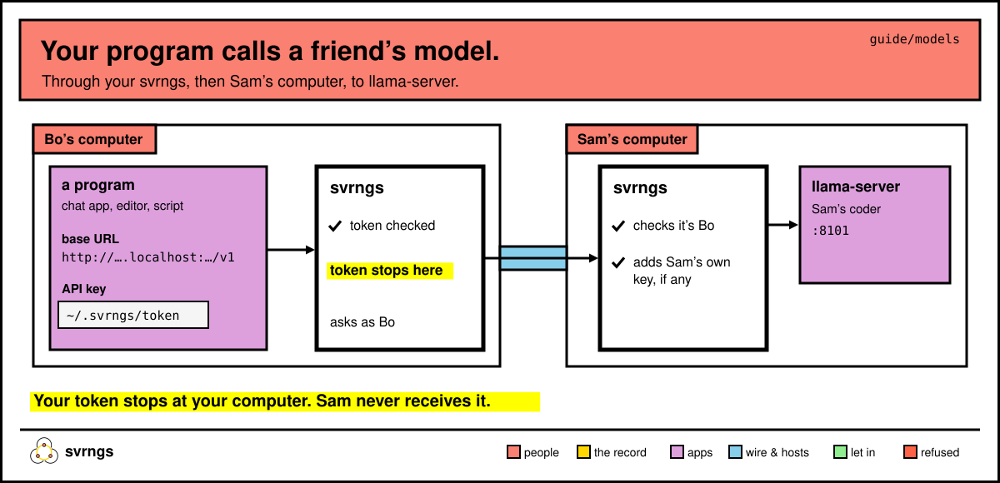
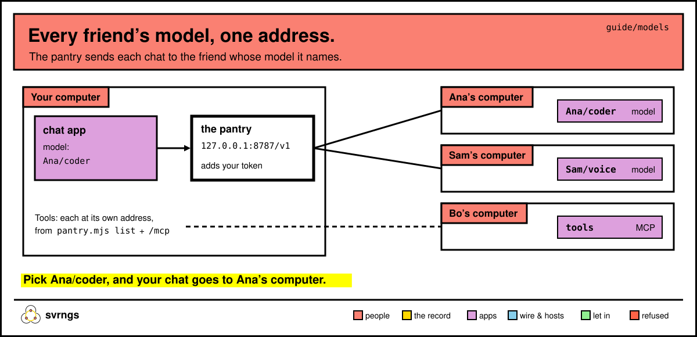

# Lend an AI model, and use a friend's

If you run a model on your computer with llama-server, your group can chat with it, and their own programs can call it, through your computer. This page covers lending one, using a friend's, and the pantry: every friend's model and tool behind one address.

In the commands below, `svrngs` means `~/.local/bin/svrngs` if your terminal doesn't find it.

## Lend your llama-server

Start llama-server as you always do, for example:

```
llama-server -m my-model.gguf --host 127.0.0.1 --port 8101
```

When `http://127.0.0.1:8101/` opens llama-server's chat page on your computer, it's ready. (Without `--port`, llama-server uses 8080.)

**From your home page:** under **Already running here**, press **Look for programs running on this computer**. svrngs doesn't know llama-server by its port (its usual 8080 is many programs' port), so the row says *"Something at http://localhost:8101. To lend it, give it a name and say which program it is, each one word; if it is llama-server, say that."* Type a name in **Its name:** (`coder`) and `llama-server` in **Which program:**, tick who can open it, then press **Lend it to House** (the button names the groups you ticked).

**From a terminal:**

```
svrngs share 8101 --program llama-server --name coder --group <group>
```

It asks *"If coder takes a password on each request, …"*. Press Enter, unless you started llama-server with `--api-key abc123`; then paste `Bearer abc123`. The key stays on your computer. Then:

```
You lend coder (port 8101) to the groups you chose, as many at once as want it. …
They cannot open /slots, /v1/stream, /v1/streams, /v1/chat/completions/control, /lora-adapters, /metrics, /tools, /cors-proxy, /models: svrngs keeps these back whenever a llama-server is lent, since they show one person's use of it to the others or change it for everyone.
```

## What svrngs keeps back, and why

`--program llama-server` tells svrngs what it is, so it closes these parts to your friends without you typing anything:

| Part | What it would let a friend do |
|---|---|
| `/slots` | see when each person's chat runs, for how long and with what settings; save or erase them on your disk |
| `/v1/stream`, `/v1/streams`, `/v1/chat/completions/control` | read another person's chat from its start, stop it, or end its reasoning |
| `/lora-adapters` | change the model for everyone |
| `/metrics` | see the server's load |
| `/tools` | run a shell on your computer (if you started it with `--tools`) |
| `/cors-proxy` | fetch any address through your computer |
| `/models` | load and remove models (`GET /v1/models` still works) |

One part stays open: `/props`, because the chat page needs it. It shows everyone the model's file path on your disk, which includes your account's name.

## Chat with a friend's model

On your home page, under your group, click *"Sam’s coder (llama-server)"* (*"Sam’s llama-server"* if Sam gave it no other name). llama-server's own chat page opens in a tab. Type in it and press Enter. On a phone, tap it on the group's page.

## Use a friend's model from a program

A chat app, an editor's assistant or a script on your computer can call Sam's model as an OpenAI-compatible server.



1. On your home page, below your group's list, find Sam's model and press **Copy its address for a program**. The page says *"Copied: http://….localhost:…/. Paste it where a program on this computer, such as a chat app, asks for an address."* The address stays the same when svrngs or your computer restarts.
2. In the program, set the OpenAI base URL to that address with `v1` on the end.
3. For the API key, give it your svrngs token: the text in `~/.svrngs/token`. svrngs lets a program on your computer through only with it, and doesn't pass it on to Sam.

In Python:

```python
from pathlib import Path
import openai

client = openai.OpenAI(
    base_url="<the address you copied>v1",
    api_key=Path("~/.svrngs/token").expanduser().read_text().strip(),
)
reply = client.chat.completions.create(model="any",
    messages=[{"role": "user", "content": "Name three rivers in Spain."}])
print(reply.choices[0].message.content)
```

With curl:

```
ADDR='<the address you copied>'
curl "${ADDR}v1/chat/completions" \
  -H "Authorization: Bearer $(cat ~/.svrngs/token)" \
  -H 'Content-Type: application/json' \
  -d '{"messages":[{"role":"user","content":"Name three rivers in Spain."}]}'
```

The address ends in `/`, so `v1/...` goes straight after it. Sam's computer has to be on, with llama-server running.

## Let only so many use it at once

A model can only answer so many people at once. Set how many:

```
svrngs share 8101 --program llama-server --name coder --limit 2 --group <group>
```

Or on your home page, under **What you lend**, type `2` in **How many people at once:** and press **Let in this many**. The third person is told *"coder is lent to 2 people at once, and 2 are using it now: try again when one stops. That number is the choice of the person who lends it, and they can change it."* Someone counts as using it for 30 seconds after their last request ends.

## The pantry: every friend's model behind one address

When Ana lends a coder, Sam a voice and Bo some tools, the pantry gathers them into one address on your computer for your chat app. It comes with svrngs's source, in `apps/pantry/`, and needs Node 18 or later.



```
node apps/pantry/pantry.mjs list
```

`list` shows what each group you're in lends now: each model with its id, each tool with whether it's read-only or destructive (or *not declared*), and each friend whose computer didn't answer, with why.

```
node apps/pantry/pantry.mjs serve
```

It says *"Point your interface at http://127.0.0.1:8787/v1"* (your number may differ). Keep it running. It uses the same address next time, so your chat app keeps working after a restart. It listens only on your own computer.

**Point your chat app at it.** In any OpenAI-compatible app, set the base URL to that address. Any API key will do: the pantry adds your svrngs token itself. The app's model list then shows ids like `Ana/coder` and `Sam/voice`: the friend's name, a slash, and the model's own name (what llama-server's `--alias` sets). Picking `Ana/coder` sends your chat to Ana's computer.

**Tools.** A friend's tool is any MCP server that speaks Streamable HTTP. Paste its address from `list`, with `/mcp` on the end, into your app's MCP settings. Like a program, your app needs to send your token, as the header `Authorization: Bearer <the text in ~/.svrngs/token>`.

To lend your own model or tool for the pantry, run it on `127.0.0.1` and lend it under any name: `svrngs share 8108 --program mcp --name tools --group <group>`. More recipes (speech, speech to text, a vision bridge) are in [apps/pantry/README.md](../../apps/pantry/README.md).

## Who sees what

- **A friend's model sees everything you send it.** Send only what you'd share with that person.
- **A friend's tool runs on their computer, as them**, with their permissions. svrngs decides who can reach it and how many at once, not what it does. Check whether `list` says it's read-only or destructive before you let a model call it.
- What a friend's tool returns goes into your model's context.
- When a friend's computer is asleep, or their model is full, the pantry says so and why. It never puts another model in its place.
