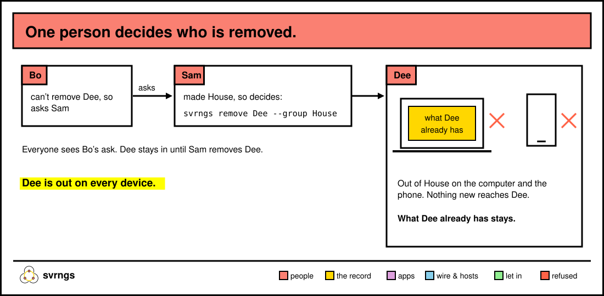

# Who's in your group

This page covers everything about who's in: inviting someone, adding your
own phone or other computer, having a guest over, removing someone, and
leaving. `svrngs` below means `~/.local/bin/svrngs` if your terminal doesn't
find it.


## Invite someone

On your home page, in your group's section, press **Invite someone to
House**. The page shows the link, with **Copy the link**:

*Send this link to the person you are inviting: … It works for a day,
while this computer is on. A new link stops this one letting anyone new in;
everyone it let in stays.*

Paste it into your chat. Or make one in a terminal:

```
~/.local/bin/svrngs link House
```

The person joining reaches your computer to get in, so keep it on until
they're in. Links are made on a computer; your group's page on a phone has
no invite button.

How the person joins, on a computer or a phone, is in [start.md](start.md).

## Add your phone or another computer

Ana wants House on a phone too. On the home page of Ana's computer, Ana presses
**Add your phone or another computer**:

*Open this link on your other computer or phone; it joins as you, so send
it to nobody else: …*

Ana opens that link on the phone, and it joins as Ana, with no name asked.
In a terminal it's:

```
~/.local/bin/svrngs link House --device
```

On another computer, `svrngs join <link>` with that link, or paste it into
**Join a group from a link** on its home page. On an iPhone, add the page to
the Home Screen first and join from there (see [start.md](start.md)).

Use this link, not an ordinary invitation, for your own devices. A phone
that joins with an ordinary link joins as a second person, even with your
name, and stays that way.

To see which of your computers and phones are in a group, open **What acts
as you** on your home page, then **Can decide for you**: *House: This
computer, your other computer, and your phone.*

## Have a guest

Cy's sister Dee is staying for the weekend and wants to watch films from
Cy's Jellyfin. Dee isn't in the group. On Cy's home page:

1. Press **Have a guest**.
2. Choose *For how long, from when they open the link*: 48 hours, 24
   hours or 6 hours.
3. Press **Make a link for your guest**, and send it in any chat.

Dee opens it in a browser. The page says *You’re invited over as a guest*
and asks Dee's name. Then it says *You’re Cy’s guest until …* and lists what
Cy lends, to open. Dee sees only what Cy lends, never anyone else's, and
never reads the group's record.

Everyone in House sees Dee under **Visiting now**: *Dee, Cy’s guest, until
Saturday 9:00 PM*. On Cy's home page Dee is under **Who you have over**,
with **Stop Dee’s visit**, which ends it now. A guest's visit is stopped
only on the computer that made the link.

A guest's link lets one guest in, once, within a day, while your computer
is on.

## Remove someone



One person decides who is removed from a group: whoever made it, until they
hand that on. Sam made House, so Sam runs:

```
~/.local/bin/svrngs remove Dee --group House
```

*Dee is no longer in House. What Dee already has stays with them; nothing
new reaches them.* Every computer and phone of Dee's is out. If Dee had
**Play** on for a game someone lends, it stops within seconds.

If Bo runs the same command, Bo can't remove Dee directly, so it asks Sam:

*You asked Sam to remove Dee from House. Dee stays in it until Sam does.*

Everyone's home page lists it in the group's section, for example *Bo
asked to remove Dee on 12 Oct 2026, 14:03*, and later *Sam removed Dee on
…*. There is no remove button on the home page; it's the command, run
while svrngs is running.

Dee's home page then says *You are no longer in House. What you already
have stays on this computer; nothing new reaches it.*

## Let someone else decide who is removed

```
~/.local/bin/svrngs handover Bo --group House
```

*Bo now decides who is removed from House, instead of you.* Only the person
who decides can hand it on. On the home page, the person who decides sees
this beside **Leave House**: *You keep the order of removals in House.
Choose who keeps it after you, then leave:* with a list of names and **Hand
it on**.

## Leave a group

On your home page, press **Leave House**. The page says first what happens:

*Leaving House stops it reaching you, and stops what you lend reaching its
people. What you have of it stays on this computer, its folder too.
Rejoining needs a new invitation, and this computer can’t rejoin yet.*

Or in a terminal:

```
~/.local/bin/svrngs leave House
```

You leave from every computer and phone of yours. The group then shows
under **Groups you left**, with where its folder still is. If you decide
who is removed, hand that on first; svrngs refuses until you do. To come
back, ask for a new invitation and join from another computer or phone:
this one can't rejoin yet.

## Two people with one name

svrngs doesn't let a newcomer join under a name someone in the group
already has. If two people still end up with one name, say a phone that
joined twice, they stay two people. Every page tells them apart by when
each joined: *sam (joined 3 Oct)*.

The commands never guess which one you mean. `svrngs remove sam --group
House` says so and gives the choices:

*svrngs cannot tell which person called sam in House you mean, so nothing
changed. Say which by when they joined, adding one of these to the command:
`--joined started`, `--joined "2026-10-12 14:03:22 -0700"`.*

Add one, quotes included:

```
~/.local/bin/svrngs remove sam --group House --joined "2026-10-12 14:03:22 -0700"
```

The people in your group's section on the home page show the same form.
`svrngs handover` takes `--joined` the same way.

## Be in several groups at once

Each group has its own section on your home page, in its own colour. What
you lend with `svrngs share` reaches everyone in all your groups. Leaving
or being removed from one group touches no other.

Two groups can share a name. The home page tells them apart by who made
each and since when: *Trip (Sam’s, since 3 Oct)*. In a command, name the
group by the first 8 letters of its id; svrngs lists them when it can't
tell:

*more than one group here is called Trip; say which by the start of its
id: …*

---

More: [start.md](start.md) to make a group and join one,
[troubleshooting.md](troubleshooting.md) for what svrngs's messages mean.
