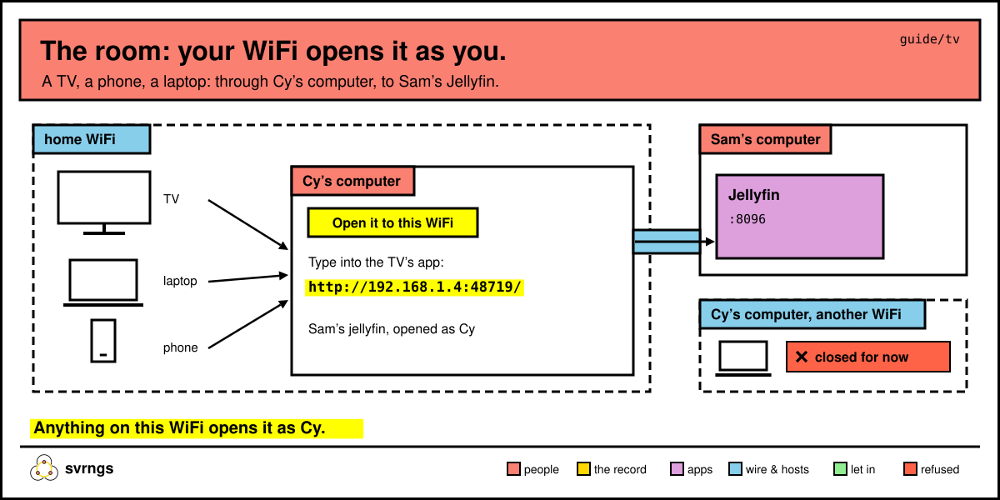

# Your TV, and other screens in the room

A TV's own app can't join a group, but your computer can open a lend to your WiFi so that the TV, a phone or another computer there opens it as you. Your home page can also put your whole group on a big screen. This page covers both, and Jellyfin on a TV from start to finish.

In the commands below, `svrngs` means `~/.local/bin/svrngs` if your terminal doesn't find it.

## Open a lend to your WiFi



On your home page, below your group's list, each lend has its own line. Find the one you want, say *"Sam’s jellyfin"*, and press **Open it to this WiFi**. The line then says:

```
Open to this WiFi: type http://192.168.1.4:48719/ into an app or a browser on a device here, such as your TV, a phone or another computer. Anyone on this WiFi can open it there as you.
```

Type that address into the TV's app, once. The number after the colon stays the same every time; the first part is your computer's address on the WiFi, and if your router gives it a new one, the line shows the new one.

From a terminal it's:

```
svrngs room jellyfin
```

That opens every lend called `jellyfin` in your groups, yours or a friend's, and prints the same lines. It works whether svrngs is running or not.

What to know:

- **It's you.** Anything on this WiFi that opens it opens it as you, so share the WiFi with people you'd lend your name to. A friend's lend counts it as one person: you.
- **This WiFi only.** It stays open whenever svrngs runs on this computer and the computer is on that WiFi, after a restart too. On another WiFi it's closed: *"Closed for now: this computer is on another WiFi than the one where you turned it on. It opens again when you are there again."*
- **Until you close it.** Press **Close it to this WiFi** on the same line. There's no terminal command for closing.
- **A firewall can stop it.** svrngs never changes this computer's firewall. If it blocks the address, allow that port for your WiFi in the firewall's own settings.
- **It's listed.** On your home page, open **What acts as you**: it shows it under **Open to this WiFi**, with its button to close it.

## Put your group on a screen

At the foot of your group's part of your home page, click **Show Lab on a screen** (it says your group's name). A tab of its own opens, at your home page's address with `?screen=` and the group after it. It shows:

- everyone in the group, lit while their computer answers (dashed: didn't answer; dotted: in from a phone);
- what each person lends, inside their window, each opening in a tab as you;
- **Since this screen opened**: who joined and what was lent, newest first, the newest marked *new*.

It reads the group again every second. Its list lives on that screen only and starts over when you open it again. It never says when someone went off; their window stops being lit.

Your home page opens only on your own computer, so put this tab on a TV or projector plugged into your computer, or on a spare laptop of yours that runs svrngs (add it with **Add your phone or another computer**).

## Jellyfin on the TV

This works for whoever's computer is in the room with the TV, on the TV's WiFi, whether the Jellyfin is yours or a friend's.

### Once: give the TV the address

1. On your home page, find Jellyfin below your group's list and press **Open it to this WiFi**. Note the address its line gives.
2. On the TV, install Jellyfin's own app from its app store and type that address into it.

### Sign the TV in without typing on its remote

1. On the TV, choose "Use Quick Connect". It shows a code.
2. On your phone, open the group's page, open Jellyfin from the list and sign in.
3. In Jellyfin on the phone: your picture at the top right, then Quick Connect, and type the code.

The TV is now signed in as that Jellyfin account. Quick Connect comes on in Jellyfin. If the TV doesn't offer it, whoever lends Jellyfin turns it on: your picture at the top right, then Dashboard, General, "Enable Quick Connect on this server", and Save.

### One account for the room, or one each?

**One account for the room is the simplest.** Whoever lends Jellyfin makes an account called `room`: your picture at the top right, then Dashboard, Users and the plus; the name `room`, a password, every library ticked, and Save. The TV signs in as `room` by Quick Connect, and that name and password go to everyone in the room. Every phone signed in as `room` finds the TV under the button at the top that casts, and can start, pause and seek on it.

The cost: the room shares one account, so a film one person plays shows as played for everyone, and starts where they left it.

**An account each keeps everyone's watching apart.** Whoever lends Jellyfin, for each person: your picture at the top right, then Dashboard, Users and their picture; tick "Allow remote control of other users", and Save. Without it, the TV doesn't appear in their list. Then on their phone, in Jellyfin: the cast button ("Cast to Device"), the TV by its name, and play the film.

The cost: once their film starts, a phone signed in as someone other than the TV loses control of it. The TV keeps playing, but that phone can't pause or seek. That's Jellyfin's own behaviour; svrngs isn't between them. The phone signed in as the TV's own account keeps control: the same cast button, then Remote Control.

This has been tried with a browser standing in for the TV; a real TV hasn't been tested yet.

To stop: press **Close it to this WiFi** on Jellyfin's line. More on lending Jellyfin itself is in [lend.md](lend.md).
